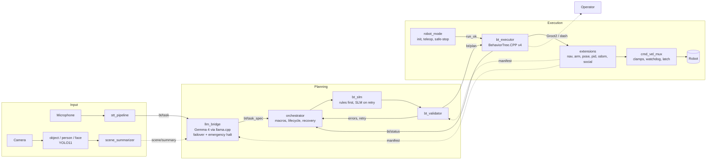
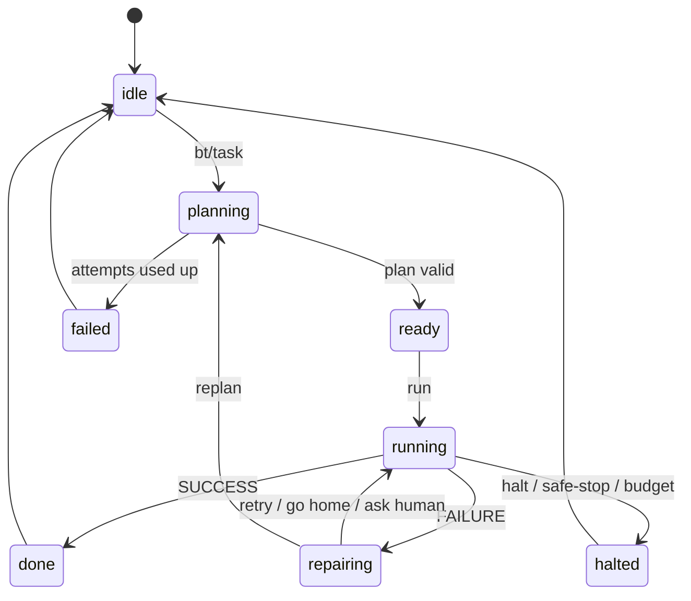

<div align="center">

# ros2-jazzy-framework

**Speak a task. Get a validated behaviour tree. Watch the robot run it.**

An LLM → SLM → validator pipeline that turns natural-language tasks into
[BehaviorTree.CPP](https://www.behaviortree.dev/) v4 plans, with YOLO11 perception, Nav2, voice in/out and a safety layer in front of the motors.

[](https://github.com/lkaixian/ros2-jazzy-framework/actions/workflows/ci.yml)


[](LICENSE)
[](https://huggingface.co/larmkaixian/bt-sim-slm)

[Quick start](#quick-start) · [Architecture](#architecture) · [Packages](#packages) · [Safety](#executing-plans-safety) · [Operator guide](docs/operator-guide.md) · [Notes](notes/README.md)

</div>

---

## Highlights

| | |
|---|---|
| **Language to plan** | Gemma 4 (llama.cpp, JSON-schema constrained) writes a task spec; macros expand it; an exact rule generator renders BT XML in 0.06 ms; a fine-tuned 230M SLM covers retries. |
| **Nothing unchecked runs** | `bt_validator` checks structure, ports, values, cycles and limits against the live node catalog. Invalid plans never reach the executor. |
| **Recovery built in** | Task lifecycle, robot mode (init / teleop / safe-stop), mission budget and a per-failure recovery policy (retry, replan, go home, ask a human). |
| **Safety in front of the motors** | `cmd_vel_mux` with priorities, clamps, 0.5 s watchdog and bumper/cliff latch; lidar and battery guards; fail-closed mode gate. |
| **See it live** | Terminal dashboard, plan tree with per-node status, and [Groot2](https://www.behaviortree.dev/groot/) monitoring on port 1667. |
| **Voice** | faster-whisper / Vosk with place-name hints and snapping; Piper / Kokoro / espeak TTS. |
| **Many machines** | Cluster scheduler, LLM failover with emergency halt, SROS2 workspaces with roles and revocation. |
| **Measured** | GPSR-style eval: 99 % on 100 generated commands, 95 % on 44 hand-written ones (see [docs/macros.md](docs/macros.md), [docs/slm-benchmark.md](docs/slm-benchmark.md)). |

## Architecture



Task lifecycle (`task/state`): `idle → planning → ready → running → done | failed | halted`, with `repairing` between a failed run and the next attempt.



## Quick start

```bash
./setup.sh --dry-run        # see what it would do; then ./setup.sh   (apt, rosdep, pip, llama.cpp, LLM + SLM base, build)
source env.sh               # system Python first, ROS, this workspace, ~/.local/bin
ros2 run framework_bringup check_params     # param files vs the real nodes
ros2 launch framework_bringup framework.launch.py dry_run:=true       # nothing moves in dry-run
ros2 topic pub --once /bt/task std_msgs/msg/String "{data: 'go to the door and say hello'}"
```

**Humble** (Ubuntu 22.04, Python 3.10) builds too: `./setup_humble.sh` (`./setup_jazzy.sh` is the default). The `build-test-humble` CI job builds and runs unit tests only; the integration sims run on Jazzy, and nothing was run on a real Humble machine or robot. Do not mix Jazzy and Humble machines on one DDS domain (unsupported; see rmw_fastrtps #797): one distro per robot, or a separate `ROS_DOMAIN_ID`.

> **Picking this up in a new session?** Read `notes/README.md` (status, architecture, runbook, gotchas), `notes/BACKLOG.md` (what is next) and `notes/technical_debt.md`.

<details>
<summary><b>Setup details</b></summary>

`setup.sh` steps: `apt rosdep python llamacpp models build` (+ optional `slm` = dataset and fine-tune). Use `--only`, `--skip`, `--minimal`, `--backend cuda|vulkan|cpu`. The LLM is fetched by `llama-server -hf` (Gemma 4 E4B), the SLM base `LiquidAI/LFM2.5-230M-Base` goes to `models/slm-base` for fine-tuning only. `nav2_params.yaml` is generated from the Jazzy Nav2 defaults, so Nav2 on Humble is untested.

</details>

## Packages

| Package | Type | Role |
|---|---|---|
| `object_detection_msgr`, `person_detection_msgr`, `face_recognition_msgr` | ament_cmake | detection messages |
| `yolo11_common` | ament_python | shared image source (topic or webcam), model loading, OpenVINO export |
| `object_detection`, `person_detection`, `face_recognition` | ament_python | YOLO11 nodes (face: YOLO11 detector + YOLO11 embeddings, gallery in `faces/`) |
| `bt_pipeline_msgs` | ament_cmake | BtPlan, ExtensionManifest, LlmQuery/GenerateXml/ValidateTree |
| `llm_bridge` | **ament_cmake (C++)** | libcurl client for llama-server over one reused TCP connection (API key from `$LLM_API_KEY`); task -> JSON task spec; `llm/query`; ordered endpoint failover with breaker, hosts joining/leaving via the cluster, `llm/status`, emergency halt when every LLM is down |
| `bt_common` | ament_python | node catalog (core + extensions, each node tagged sync/async for the LLM), macros engine, extension base class |
| `bt_slm` | ament_python | SLM XML generator (HF transformers) + exact rule-based generator (`rules_first`: tried before the model) |
| `bt_validator` | ament_python | structural/port/cycle/limit checks on BT XML |
| `bt_orchestrator` | ament_python | macro expansion, generate -> validate -> retry loop, task lifecycle (`task/state`) with optional LLM repair of a failed run (`max_repairs`); scene summarizer (people with distance/gestures, known faces) |
| `bt_executor` | **ament_cmake (C++)** | runs validated `bt/plan` with BehaviorTree.CPP; **`dry_run:=true` and `auto_run:=false` by default**; `bt_executor/run`, `bt_executor/halt`, `bt/status` |
| `odom_extension` | ament_python | NavigateTo, DriveDistance, RotateBy, IsAtGoal (odometry frame only) |
| `pid_extension` | ament_python | HoldHeading, FollowTarget (bbox-based, no depth), SetPidGains |
| `social_extension` | ament_python | `Speak` (TTS, `{person}` placeholder) and `EnrollFace` (face gallery) |
| `nav_extension` | ament_python | Nav2 BT nodes: `NavigateToPose`, `NavigateToPlace`, `SetInitialPose`, `ClearCostmaps`, `SaveMap`, `IsNearPose` |
| `nav_sim` | ament_python | 2D simulator (ray-cast lidar + odometry on a map) to test Nav2/SLAM without a robot |
| `pose_extension` | ament_python | GetPersonPose, IsPersonWaving, IsPersonPointing from YOLO11-pose keypoints |
| `arm_extension` | ament_python | MoveArmToPose / OpenGripper / CloseGripper through MoveIt `MoveGroup` + `GripperCommand`; arm model is a parameter set |
| `bt_common` also ships | | `cmd_vel_mux_node`: priority + 0.5 s watchdog + hard clamps in front of the robot's `cmd_vel` |
| `audio_msgr` | ament_cmake | AudioChunk, Transcript, TtsStatus, Speak service |
| `audio_capture` | ament_python | microphone (`arecord`) or WAV file -> `audio/raw` |
| `stt_pipeline` | ament_python | energy VAD -> STT engine (faster-whisper / Vosk) -> `stt/transcript`; `transcript_to_task` (optional wake word) -> `bt/task`; mutes while the robot speaks |
| `tts_pipeline` | ament_python | queued TTS (espeak / Piper / Kokoro-82M), `tts/say`, `tts/speak`, `tts/stop`, `tts/status`; `plan_announcer` speaks `bt/plan` results |
| `dstar_lite_planner` | **ament_cmake (C++)** | Nav2 global planner plugin: incremental D* Lite, `planner:=dstar_lite` (NavFn stays the default) |
| `framework_bringup` | ament_cmake | `launch/`: `framework`, `perception`, `pipeline`, `extensions`, `audio`; tools `check_params`, `dash` (terminal status/logs), `ws` (workspaces); `param/` incl. `macros.yaml`, `llm_knowledge.md` |

## Parameters
Everything tunable lives in `src/framework_bringup/param/*.yaml` (`perception`, `pipeline`, `llama_server`, `extensions`, `audio`). Precedence: package defaults < these files < launch arguments (only arguments you actually pass override). Edit and relaunch; no rebuild needed. Another folder: `params_dir:=/path`. `check_params` starts every node with these files and reports typo'd keys and wrong types, which ROS would otherwise ignore silently. Per-package `launch/<pkg>.launch.py` files use the package's own `config/` defaults, not `param/`.

## Your own detector (bounding boxes only)
Plain YOLO11 boxes, no segmentation (a 4 GB GPU cannot afford SAM-class models). Verified on a GTX 1650: the nano detector runs ~10 ms/frame (~95 FPS) using ~100 MiB of VRAM, and a smoke fine-tune at batch 8 / 640 px peaked at **1.6 GB**.
```
ros2 run object_detection train_detector --data my_items.yaml --base yolo11n.pt --epochs 100   # defaults sized for 4 GB
# then in param/perception.yaml:  object_detection_node.model: <path to best.pt>
ros2 run bt_slm make_bt_dataset --labels @my_labels.txt --out-dir bt_dataset                   # SLM data with YOUR labels
```
The detector publishes its class names (`object_detection/classes`, latched). The validator then **rejects any `DetectObject label` the model cannot produce**, and the LLM prompt lists those labels plus every usable BT node with its description (`bt_validator/catalog`). Without a running detector set `bt_validator_node.labels` in `param/pipeline.yaml` or use `validate_bt --labels a,b,c`. Boxes: `ObjectArray` (`x_min,y_min,x_max,y_max` in pixels), annotated frames on `detections/image`.
Training needs matplotlib importable; if pip's NumPy 2 and apt's matplotlib clash, `train_detector` says so and `./setup.sh --only python` installs a compatible one.

## Navigation
Nav2 + slam_toolbox (default 2D SLAM; Cartographer and RTAB-Map optional) + RealSense, with Nav2's output going through the safety mux. See **docs/navigation.md** for how to map, localize and navigate, and **the static transforms in `param/navigation.yaml` are placeholders you must measure**.
```
ros2 launch framework_bringup navigation.launch.py slam:=slam_toolbox         # map
ros2 launch framework_bringup navigation.launch.py map:=$HOME/maps/room1.yaml  # navigate
ros2 launch framework_bringup nav_sim.launch.py                                # no robot needed
ros2 launch framework_bringup nav_sim.launch.py planner:=dstar_lite            # D* Lite instead of NavFn
```
Global planner: `planner:=navfn` (default) or `dstar_lite` (`src/dstar_lite_planner`, an incremental D* Lite ported from `lkaixian/dstarlite-py`: 8-connected, costmap-aware, repairs only changed cells). On the sample map both drive the door route in 45.5 s (the controller sets the speed); planning itself is not faster: NavFn needs ~0.5-1.5 ms, D* Lite 0.7 ms for a repeated goal but ~6 ms for a new one and 38 ms for the first call. Keep NavFn unless replanning becomes a problem on the real robot.

## Hand-written behaviour trees
```
ros2 run bt_validator validate_bt --list-nodes          # every node + ports you may use
ros2 run bt_validator validate_bt my_tree.xml           # check offline, readable errors
ros2 run bt_orchestrator submit_bt my_tree.xml --run    # validate -> bt_executor (dry-run unless dry_run:=false)
```
Examples in `framework_bringup/behavior_trees/`: `greet_person.xml` (detect person -> `ExtractFaceFeature` -> `Speak "Hello {person}"`) and `enroll_person.xml` (`EnrollFace`). Port names `name` and `ID` are reserved by BehaviorTree.CPP and are rejected. Speak needs `tts_node` (`audio.launch.py enable_stt:=false`), EnrollFace/ExtractFaceFeature need `face_recognition_node` (publishes embeddings).

## Cluster (several machines)
`cluster_msgs` + `cluster_core`: one agent per machine, one scheduler, job catalog in `param/cluster_jobs.yaml`; places jobs by role/tags/capacity, fails movable jobs over, keeps hardware-bound jobs (`odom`, `pid`, `cmd_vel_mux`) on the `core` host, adopts state after a scheduler restart. Control plane only (data still flows directly over DDS). `ros2 launch framework_bringup cluster.launch.py role:=agent host_id:=pi roles:=core tags:=camera`, `ros2 run cluster_core cluster_status`, offline `plan_preview`. See `docs/cluster.md` (setup, failure semantics, security, measured numbers). Verified on one machine with simulated hosts only; not on a second machine or WiFi.

## LLM link, failover and emergency halt
`llm_bridge` talks to `llama-server` over HTTP/TCP with one reused keep-alive connection and sends `Authorization: Bearer $LLM_API_KEY` when the variable is set (the llama-server machine exports `LLAMA_API_KEY`; the key never goes in YAML or argv). Endpoints are an ordered list: hosts that run an LLM job advertise it in their cluster heartbeat (`llm_big` = Gemma E4B on the strong PC, `llm_small` = Gemma E2B on the robot laptop, see `param/cluster_jobs.yaml`), a host that joins is used once its `/health` passes and one that goes silent is dropped after 4 s, and `server_urls` stay as static fallbacks. A per-endpoint circuit breaker skips dead servers. If **every** endpoint is down the bridge calls `bt_executor/halt` (repeated while the outage lasts) and `llm/status` goes `down`. `param/llm_knowledge.md` (robot limits, places, rules; guarded by a test against the node catalog and `places.yaml`) is appended to every planning prompt. Verified with fake servers and the real cluster agent/scheduler on one machine; a real `llama-server` and a second machine were not tried.

## Workspaces and security (SROS2)
A workspace = an SROS2 keystore (authentication + encryption, `Enforce`) + a DDS domain + an LLM API key + a join token.
```
ros2 run framework_bringup ws create lab             # first machine: prints the invite
source ~/.robocup/workspaces/lab/env.sh              # every terminal that should be inside it
ros2 run framework_bringup ws serve lab              # admits machines, announces itself on the LAN
ros2 run framework_bringup ws discover               # other machine: what is announced here?
ros2 run framework_bringup ws join lab --token ...   # then: source $(ros2 run framework_bringup ws env lab)
```
Join runs over TLS; both sides prove they know the token with an HMAC bound to the certificate the client saw, so a wrong token, an impostor server and a relaying man-in-the-middle all get nothing (tested). Outsiders and nodes holding another workspace's keys cannot see or talk to workspace nodes (tested). **Roles:** `ws invite lab --role observer|operator` prints an invite with its own token; the member's SROS2 enclave then only allows that role's topics (`observer` reads everything and publishes only ROS housekeeping, `operator` also publishes `bt/task` and `teleop/cmd_vel`; DDS Security enforces it, tested: an observer reads, its writer is refused). **Revocation:** `ws revoke lab HOST` removes the member, rotates all tokens and the LLM key and re-keys the workspace (new CA), so the old keys stop working; the other members re-run `ws join`. **Limits:** tested on one machine only; roles are fixed in `ws.py` (`ROLES`), not configurable per topic; after `revoke` restart llama-server with the new key; the owner cannot be revoked. `tools/net/cyclonedds_lan.xml` is a multicast-off peer-list discovery config. Details: `notes/RUNBOOK.md`, `notes/technical_debt.md` T-03.

## Dashboard
```
ros2 run framework_bringup dash            # 1 Hz: domain + SROS2 state, LLM endpoints with link type and TCP ms, Kobuki battery, task state, the plan tree with live node status, cluster jobs, every node ONLINE/BUSY/ERROR/OFFLINE
ros2 run framework_bringup dash --logs --level warn --node llm_bridge     # verbose /rosout stream
```
The **plan tree** comes from `bt_executor` (`bt/tree` + `bt/node_status`): `>` running, `+` done, `x` failed, `-` halted, `.` not reached; `t` hides it. Keys: `j/k` select a node, `r/R` restart it (graceful/force; the launch files respawn it), `s/S` stop the system, `w/W` restart it, `h` halt the task; `s S w W` ask y/n. The link type describes this machine's side of the route to each endpoint. Everything an operator types is in `docs/operator-guide.md`; `ros2 run framework_bringup teleop` takes over with the keyboard (highest `cmd_vel_mux` priority, halts the plan on the first key).

## Machine health
`ros2 run cluster_core host_info [host_id]` prints CPU, RAM, GPU utilisation and VRAM, temperature and battery of every machine that runs a `cluster_agent` (service `host_info/<host_id>`, type `cluster_msgs/srv/HostInfo`; the same numbers are in the ~2 Hz `cluster/node_info` heartbeat). A desktop PC reports battery `-`; no NVIDIA driver reports GPU `-`.

## Macros and the task lifecycle
`param/macros.yaml` holds 36 named, parameterised step lists (`go_to_place`, `go_and_say`, `patrol`, `wander`, `meet_guest`, `receive_guest`, `scout_room`, ...; full list in `docs/macros.md`, generated; only the `whitelist:` ones may be called by the LLM/SLM). Task specs can also use `repeat`, `Parallel` groups and `foreach` loops (`docs/task-spec-grammar.md`). The LLM can write `{"macro": "go_to_place", "args": {"place": "door"}}`; the orchestrator expands it to real nodes before the SLM/rule generator, and a test expands and validates every macro against the real node catalog. Bad calls refuse the plan with a message naming the problem. Add your own by adding an entry with `example_args`. The rule-based generator is exact for every spec in the grammar and was measured at 0.06 ms against 1.5 s for the fine-tuned 230M model (GTX 1650), so `bt_slm` tries the rules first and the model only handles retries or specs the rules cannot render. The spec grammar still has no Parallel/loops/blackboard planning.
`task/state` (latched) follows planning -> ready -> running -> done/failed/halted. With `bt_orchestrator.max_repairs > 0` a failed run is re-planned through the LLM with the failing node (`failed_node` in `bt/status`); default 0. Every Action/Condition node is tagged `sync` or `async` in the LLM's node list (derived from how `bt_executor` really runs it).

## Launch files
* `launch/` (workspace root): `framework`, `perception`, `pipeline`, `extensions`, `audio`, `cluster`; thin wrappers, e.g. `ros2 launch launch/framework.launch.py dry_run:=true`.
* `src/framework_bringup/launch/`: the real entry points the wrappers include (all arguments are documented there).
* Every runnable package has its own `launch/<package>.launch.py` to start it alone (`ros2 launch bt_validator bt_validator.launch.py`).

## Build / run
Use the system Python first on PATH (a `~/pyvenv.cfg` can shadow it and break `empy`):
```
export PATH=/usr/bin:$PATH; source /opt/ros/jazzy/setup.bash
colcon build --symlink-install && source install/setup.bash
ros2 launch framework_bringup framework.launch.py image_topic:=/camera/image_raw \
    start_llama_server:=true slm_model_path:=/path/to/finetuned-slm
ros2 topic pub --once /bt/task std_msgs/msg/String "{data: 'fetch the cup'}"
ros2 topic echo /bt/plan
# voice in/out (opens the microphone; needs an STT engine: pip install faster-whisper  or  vosk)
ros2 launch framework_bringup framework.launch.py enable_audio:=true wake_word:=robot
ros2 launch framework_bringup audio.launch.py tts_engine:=kokoro tts_voice:=<voice> \
    kokoro_model:=kokoro-v1.0.onnx kokoro_voices:=voices-v1.0.bin
```
Python edits need `colcon build` again: in this setup `--symlink-install` copies Python files into `install/`.

## Models
**Local setup that was verified (GTX 1650, 4 GB):** see `notes/RUNBOOK.md` "Local LLM + voice": prebuilt llama.cpp (CUDA 12.8), Gemma 4 E2B, `--reasoning off`, constrained JSON-schema decoding with the macro whitelist (`param/macros.yaml`), Piper TTS and faster-whisper STT. `./setup.sh --only llamacpp,voice --backend prebuilt` reproduces it.
* LLM: Gemma 4 E4B via `llama-server -hf ggml-org/gemma-4-E4B-it-GGUF` (needs a llama.cpp build with Gemma 4 support).
* SLM: `LiquidAI/LFM2.5-230M-Base`, fine-tuned on synthetic pairs labelled by the validator:
  ```
  ros2 run bt_slm make_bt_dataset --out-dir bt_dataset --n 30000        # generate + repair rows
  pip install transformers
  ros2 run bt_slm finetune_bt_slm --data-dir bt_dataset --out bt_slm_model
  ros2 launch framework_bringup framework.launch.py slm_model_path:=$PWD/bt_slm_model
  ```
  Until `slm_model_path` is set, a deterministic rule-based generator (the dataset's ground truth) is used, and with a model set it still runs first (`rules_first`). The spec grammar is sequence/fallback groups with retries plus macros; richer structure (Parallel, SubTree) needs grammar and data extensions. One fine-tune has been run (3000 synthetic rows, batch 1, 1 epoch on a GTX 1650; the default batch size does not fit 4 GB): 99 % valid / 98.5 % exact on 200 held-out rows, measured against the rule-based generator, so it shows the model learned the rules and nothing about real LLM output.
* YOLO11 weights (`yolo11n.pt`, `yolo11n-pose.pt`) download on first use; face weights must be supplied (`yolov11n-face.pt`).

## Executing plans (safety)
`framework.launch.py` starts `bt_executor` in **dry-run**: extension nodes are only logged and succeed, nothing moves. To command hardware you must pass `dry_run:=false`, and by default a plan still waits for `ros2 service call /bt_executor/run std_srvs/srv/Trigger` (`auto_run:=true` runs each valid plan immediately). `ros2 service call /bt_executor/halt ...` stops the tree and cancels the running extension goal.
All motion goes through `cmd_vel_mux_node` (clamps `max_linear`/`max_angular`; zero Twist if no input for `timeout_sec`=0.5 s, so a crashed extension coasts at most ~0.5 s at its last command). Kobuki bumper/cliff events latch the mux to zero until the `safety_reset` service is called (refused while a sensor is still hit; sim-verified only). The mux is a software gate, **not** an e-stop: keep a hardware stop within reach.
Guards (no replacement for a hardware e-stop): the lidar stops `DriveDistance`/`NavigateTo` (0.30 m) and `FollowTarget approach` (0.40 m) and `RotateBy` refuses to turn with anything within 0.22 m (set `scan_required: true` on the real robot); `battery_guard_node` halts the plan when the Kobuki battery is below 13.2 V for 3 s. `ros2 run framework_bringup preflight` checks the stack before a run. Tools: `tools/record_run.sh` (rosbag2), `tools/net/timesync.sh` (chrony for two machines), `tools/systemd/` (restart-always units), `.flake8` + `requirements-lock.txt` (lint and pinned versions).
Arm: pass `arm_group:=... arm_ee_link:=... arm_base_frame:=... gripper_action:=...` once the arm is chosen; with those empty `arm_extension` refuses to move. Velocity scale is capped at 0.1 by default.

## Audio engines
STT: `faster_whisper` or `vosk` (neither is installed by default; the node refuses to start without it). `mock` only tests the plumbing.
TTS: `espeak` works out of the box; `piper` needs `pip install piper-tts` plus a voice `.onnx`; `kokoro` needs `pip install kokoro-onnx` plus the model and voices files.

## Status
Verified: workspace builds; validator/SLM-fallback unit tests and C++ gtest pass; the pipeline ran end-to-end against a stub llama server (including a rejected-then-repaired attempt). Audio plumbing was verified with a synthesized WAV and mock engines (VAD -> transcript -> `bt/task`; TTS status).
Execution was verified in a **simulated** robot (a node integrating `cmd_vel` into `odom`): task -> stub llama -> SLM fallback -> validator -> `bt_executor` -> `odom_extension` -> mux -> robot, covering a live drive+turn (0.29 m / 0.47 rad requested 0.30 / 0.50), dry-run (no motion), halt mid-drive, and SIGKILL of the extension (mux stops the robot within its timeout). Controllers and PID have closed-loop unit tests; gesture rules are tested on synthetic skeletons only.
The greeting/enrolment trees were run through the real chain against a **fake perception node** and the mock TTS engine (spoke `Hello alice` / `Hello there`, enrolled via a stub service); the real YOLO face node, face embeddings and neural TTS were not exercised. Not verified: `setup.sh` apt/pip/llama.cpp/model steps (dry-run only; `--only build` was run), any real robot, MoveIt/arm execution (only goal construction is tested), gesture accuracy on real video, the fine-tuned SLM on real LLM output (see Models), the YOLO nodes on a camera, a real llama-server, any two-machine or WiFi setup (cluster, workspaces, LLM failover), face/pose models (the scene-summary path was fed synthetic skeletons), the Kobuki bumper/cliff latch and a real RPLIDAR with SLAM (simulated lidar only), real STT recognition (faster-whisper/Vosk), Piper and Kokoro playback, live microphone capture.
CI: `.github/workflows/ci.yml` (job `build-test` on ROS Jazzy; `build-test-humble` builds and unit-tests on Humble) builds, runs the Python tests and gtests, `check_params`, `--show-args` on every launch file and the integration sims in `tools/integration/` on every push; check the Actions tab for the current result. Detailed status, gotchas and ranked debt: `notes/`.
