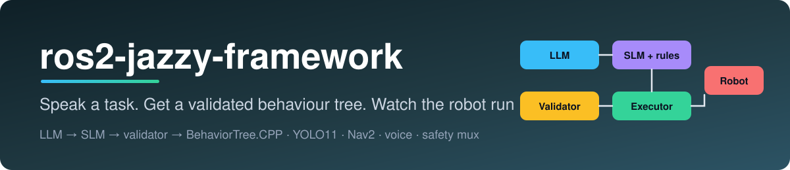
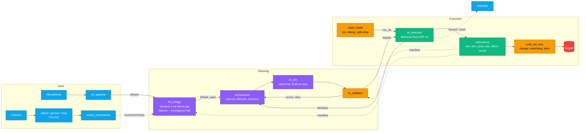
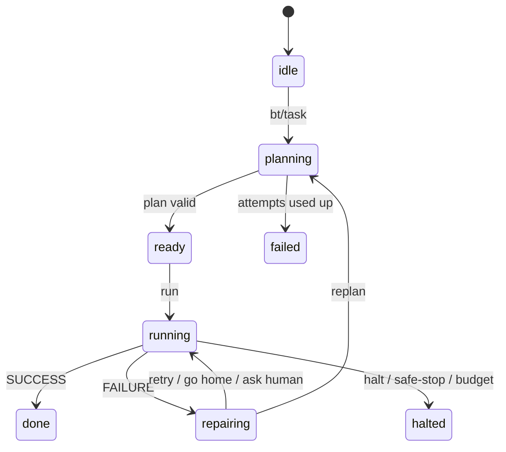

<div align="center">



# ros2-jazzy-framework

**Speak a task. Get a validated behaviour tree. Watch the robot run it.**

An LLM → SLM → validator pipeline that turns natural-language tasks into
[BehaviorTree.CPP](https://www.behaviortree.dev/) v4 plans, with YOLO11 perception, Nav2, voice in/out and a safety layer in front of the motors.

[](https://github.com/lkaixian/ros2-jazzy-framework/actions/workflows/ci.yml)


[](LICENSE)
[](https://huggingface.co/larmkaixian/bt-sim-slm)

[Quick start](#quick-start) · [Architecture](#architecture) · [Packages](#packages) · [Safety](#executing-plans-safety) · [Operator guide](docs/operator-guide.md) · [Notes](notes/README.md)

</div>

---

## Highlights

| | |
|---|---|
| **Language to plan** | Gemma 4 (llama.cpp, JSON-schema constrained) writes a task spec; macros expand it; an exact rule generator renders BT XML in 0.06 ms; a fine-tuned 230M SLM covers retries. |
| **Nothing unchecked runs** | `bt_validator` checks structure, ports, values, cycles and limits against the live node catalog. Invalid plans never reach the executor. |
| **Recovery built in** | Task lifecycle, robot mode (init / teleop / safe-stop), mission budget and a per-failure recovery policy (retry, replan, go home, ask a human). |
| **Safety in front of the motors** | `cmd_vel_mux` with priorities, clamps, 0.5 s watchdog and bumper/cliff latch; lidar and battery guards; fail-closed mode gate. |
| **See it live** | Terminal dashboard, plan tree with per-node status, and [Groot2](https://www.behaviortree.dev/groot/) monitoring on port 1667. |
| **Voice** | faster-whisper / Vosk with place-name hints and snapping; Piper / Kokoro / espeak TTS. |
| **Many machines** | Cluster scheduler, LLM failover with emergency halt, SROS2 workspaces with roles and revocation. |
| **Measured** | GPSR-style eval: 99 % on 100 generated commands, 95 % on 44 hand-written ones (see [docs/macros.md](docs/macros.md), [docs/slm-benchmark.md](docs/slm-benchmark.md)). |

## Architecture



Task lifecycle (`task/state`): `idle → planning → ready → running → done | failed | halted`, with `repairing` between a failed run and the next attempt.



## Quick start

```bash
./setup.sh --dry-run        # see what it would do; then ./setup.sh   (apt, rosdep, pip, llama.cpp, LLM + SLM base, build)
source env.sh               # system Python first, ROS, this workspace, ~/.local/bin
ros2 run framework_bringup check_params     # param files vs the real nodes
ros2 launch framework_bringup framework.launch.py dry_run:=true       # nothing moves in dry-run
ros2 topic pub --once /bt/task std_msgs/msg/String "{data: 'go to the door and say hello'}"
```

**Humble** (Ubuntu 22.04, Python 3.10) builds too: `./setup_humble.sh` (`./setup_jazzy.sh` is the default). The `build-test-humble` CI job builds and runs unit tests only; the integration sims run on Jazzy, and nothing was run on a real Humble machine or robot. Do not mix Jazzy and Humble machines on one DDS domain (unsupported; see rmw_fastrtps #797): one distro per robot, or a separate `ROS_DOMAIN_ID`.

> **Picking this up in a new session?** Read `notes/README.md` (status, architecture, runbook, gotchas), `notes/BACKLOG.md` (what is next) and `notes/technical_debt.md`.

<details>
<summary><b>Setup details</b></summary>

`setup.sh` steps: `apt rosdep python llamacpp models build` (+ optional `slm` = dataset and fine-tune). Use `--only`, `--skip`, `--minimal`, `--backend cuda|vulkan|cpu`. The LLM is fetched by `llama-server -hf` (Gemma 4 E4B), the SLM base `LiquidAI/LFM2.5-230M-Base` goes to `models/slm-base` for fine-tuning only. `nav2_params.yaml` is generated from the Jazzy Nav2 defaults, so Nav2 on Humble is untested.

</details>

## Packages

| Package | Type | Role |
|---|---|---|
| `object_detection_msgr`, `person_detection_msgr`, `face_recognition_msgr` | ament_cmake | detection messages |
| `yolo11_common` | ament_python | shared image source (topic or webcam), model loading, OpenVINO export |
| `object_detection`, `person_detection`, `face_recognition` | ament_python | YOLO11 nodes (face: YOLO11 detector + YOLO11 embeddings, gallery in `faces/`) |
| `bt_pipeline_msgs` | ament_cmake | BtPlan, ExtensionManifest, LlmQuery/GenerateXml/ValidateTree |
| `llm_bridge` | **ament_cmake (C++)** | libcurl client for llama-server over one reused TCP connection (API key from `$LLM_API_KEY`); task -> JSON task spec; `llm/query`; ordered endpoint failover with breaker, hosts joining/leaving via the cluster, `llm/status`, emergency halt when every LLM is down |
| `bt_common` | ament_python | node catalog (core + extensions, each node tagged sync/async for the LLM), macros engine, extension base class |
| `bt_slm` | ament_python | SLM XML generator (HF transformers) + exact rule-based generator (`rules_first`: tried before the model) |
| `bt_validator` | ament_python | structural/port/cycle/limit checks on BT XML |
| `bt_orchestrator` | ament_python | macro expansion, generate -> validate -> retry loop, task lifecycle (`task/state`) with optional LLM repair of a failed run (`max_repairs`); scene summarizer (people with distance/gestures, known faces) |
| `bt_executor` | **ament_cmake (C++)** | runs validated `bt/plan` with BehaviorTree.CPP; **`dry_run:=true` and `auto_run:=false` by default**; `bt_executor/run`, `bt_executor/halt`, `bt/status` |
| `odom_extension` | ament_python | NavigateTo, DriveDistance, RotateBy, IsAtGoal (odometry frame only) |
| `pid_extension` | ament_python | HoldHeading, FollowTarget (bbox-based, no depth), SetPidGains |
| `social_extension` | ament_python | `Speak` (TTS, `{person}` placeholder) and `EnrollFace` (face gallery) |
| `nav_extension` | ament_python | Nav2 BT nodes: `NavigateToPose`, `NavigateToPlace`, `SetInitialPose`, `ClearCostmaps`, `SaveMap`, `IsNearPose` |
| `nav_sim` | ament_python | 2D simulator (ray-cast lidar + odometry on a map) to test Nav2/SLAM without a robot |
| `pose_extension` | ament_python | GetPersonPose, IsPersonWaving, IsPersonPointing from YOLO11-pose keypoints |
| `arm_extension` | ament_python | MoveArmToPose / OpenGripper / CloseGripper through MoveIt `MoveGroup` + `GripperCommand`; arm model is a parameter set |
| `bt_common` also ships | | `cmd_vel_mux_node`: priority + 0.5 s watchdog + hard clamps in front of the robot's `cmd_vel` |
| `audio_msgr` | ament_cmake | AudioChunk, Transcript, TtsStatus, Speak service |
| `audio_capture` | ament_python | microphone (`arecord`) or WAV file -> `audio/raw` |
| `stt_pipeline` | ament_python | energy VAD -> STT engine (faster-whisper / Vosk) -> `stt/transcript`; `transcript_to_task` (optional wake word) -> `bt/task`; mutes while the robot speaks |
| `tts_pipeline` | ament_python | queued TTS (espeak / Piper / Kokoro-82M), `tts/say`, `tts/speak`, `tts/stop`, `tts/status`; `plan_announcer` speaks `bt/plan` results |
| `dstar_lite_planner` | **ament_cmake (C++)** | Nav2 global planner plugin: incremental D* Lite, `planner:=dstar_lite` (NavFn stays the default) |
| `framework_bringup` | ament_cmake | `launch/`: `framework`, `perception`, `pipeline`, `extensions`, `audio`; tools `check_params`, `dash` (terminal status/logs), `ws` (workspaces); `param/` incl. `macros.yaml`, `llm_knowledge.md` |

## Documentation

Everything is also on the **[project wiki](https://github.com/lkaixian/ros2-jazzy-framework/wiki)** (generated from `docs/`). New here? Start with [Start here](docs/start-here.md).

| | |
|---|---|
| **Start** | [Start here](docs/start-here.md) · [Concepts and glossary](docs/concepts-and-glossary.md) · [Tutorial: your first plan](docs/tutorial-first-plan.md) · [FAQ](docs/faq.md) |
| **Understand** | [Architecture](docs/architecture.md) · [Topics, services, actions](docs/interfaces.md) · [Robot mode and recovery](docs/robot-mode-and-recovery.md) · [Safety](docs/safety.md) · [Status: verified and not](docs/status.md) |
| **Plan** | [Task spec grammar](docs/task-spec-grammar.md) · [Macros](docs/macros.md) · [BT node catalog](docs/node-catalog.md) · [Validator rules](docs/validator-rules.md) · [Behaviour trees](docs/behavior-trees.md) · [LLM and models](docs/llm-and-models.md) |
| **Operate** | [Operator guide](docs/operator-guide.md) · [Configuration and launch](docs/configuration.md) · [Parameters](docs/parameters.md) · [Dashboard and Groot2](docs/dashboard.md) · [Troubleshooting](docs/troubleshooting.md) |
| **Robot** | [Perception](docs/perception.md) · [Navigation](docs/navigation.md) · [Audio](docs/audio.md) · [Writing an extension](docs/writing-an-extension.md) |
| **Learning** | [World In-Context Learning (task memory, sim-only, off by default)](docs/wicl.md) |
| **Models** | [Evaluation](docs/evaluation.md) · [SLM training](docs/slm-training.md) · [SLM benchmark](docs/slm-benchmark.md) |
| **Many machines** | [Cluster](docs/cluster.md) · [Workspaces and security](docs/workspaces-security.md) |
| **Reference** | [Messages](docs/messages.md) · [Testing and CI](docs/testing-and-ci.md) · engineering notes in [notes/](notes/README.md) |

## Status

Tested in simulation and in CI on every push (Jazzy: build, unit tests, gtests, `check_params`, launch checks and the integration sims in `tools/integration/`; Humble: build and unit tests). **Not yet run on a real robot, a second machine, a real arm or real microphone audio.** The full list of what was and was not verified is in [docs/status.md](docs/status.md). Keep a hardware e-stop within reach: the software mux is not one.

## License

Apache-2.0, see [LICENSE](LICENSE).
