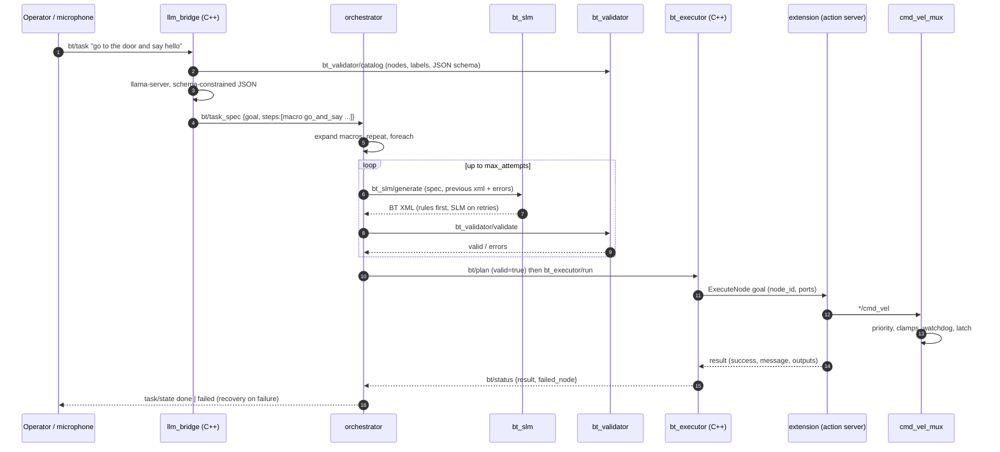
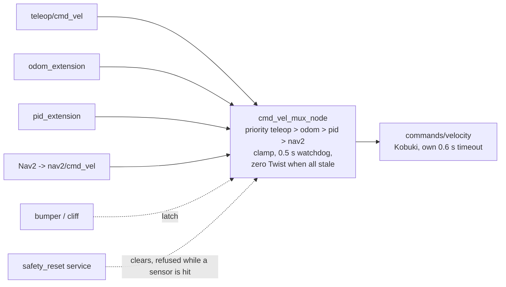

# Architecture

The framework is a harness around two brains: a slow, flexible one (an LLM that understands the request) and a fast, strict one (rules and a 230M model that render exact BehaviorTree XML). Nothing the planners produce runs until a deterministic validator accepts it, and nothing moves the robot except through the safety mux.

## End to end

1. **Input.** `bt/task` is plain text, from `transcript_to_task` (voice), `ros2 topic pub` or the dashboard. Perception feeds `scene/summary` (who is in view, distance, gestures, known faces) which is appended to the planning prompt.
2. **LLM.** `llm_bridge` is C++ with libcurl and one reused keep-alive connection. It asks the validator for the live catalog, builds a JSON schema from it (nodes, ports, macro whitelist, detector labels) and sends it as `response_format` so the model can only produce a well-formed task spec. Ordered endpoints with a circuit breaker give failover (Gemma E4B on a strong PC, E2B on the laptop). If every endpoint is down the bridge calls `bt_executor/halt`.
3. **Orchestrator.** Expands macros (`param/macros.yaml`), `repeat` and `foreach`, refuses plans with a message that names the problem, and runs the generate, validate, retry loop. It owns the task lifecycle (`task/state`) and the recovery policy.
4. **Generator.** `bt_slm` tries the exact rule-based generator first (0.06 ms; exact for every spec in the grammar). The fine-tuned SLM only handles retries or specs the rules cannot render.
5. **Validator.** Structure, ports, values, cycles, limits, detector labels (see [Validator rules](validator-rules.md)).
6. **Executor.** `bt_executor` runs a valid plan with BehaviorTree.CPP v4. It starts in dry-run and waits for `bt_executor/run`. Each extension node becomes a goal to `<extension>/execute`.
7. **Extensions** are separate processes (Nav2, arm, pose, pid, odom, social) that declare their nodes with a YAML manifest and execute them as action servers.
8. **Safety.** Everything that moves goes through `cmd_vel_mux_node` (priority, clamps, 0.5 s watchdog, bumper/cliff latch). Lidar and battery guards live in the nodes that move the robot, not in the prompt.

## Velocity chain

## Task lifecycle

`task/state` is latched JSON from the orchestrator: `idle | planning | ready | running | repairing | done | failed | halted`. With `max_repairs > 0` a failed run goes through the [recovery policy](robot-mode-and-recovery.md). `bt/repair` carries the failure to the LLM when the policy chooses a replan.

## Design decisions and why

| Decision | Reason |
|---|---|
| The validator is the single source of truth for what planners may use | The SLM prompt, the LLM schema and the executor registration all derive from the same catalog, so they cannot disagree. |
| Macros and a task-spec grammar instead of bigger prompts | Whitelisted macros are expanded in plain code before the generator, so the SLM prompt format never changed. |
| Constrained decoding | A JSON schema from the catalog removes malformed output. Property order is part of the contract (`ordered_json`): llama.cpp emits properties in schema order, and alphabetical order made the model pick macros without args. |
| Safety outside the planner | Guards sit in the nodes that move the robot; the executor is dry-run by default; a plan still waits for `run`. |
| Port values are strings end to end | Blackboard references (`{who}`) work uniformly; extensions parse and range-check their own ports. |
| Plain bounding boxes | A 4 GB GPU cannot afford segmentation models; the detector owns the label vocabulary. |
| One parameter folder | `framework_bringup/param/`: package defaults < files < launch arguments you pass. `check_params` catches silently ignored keys. |
| Cluster is control plane only | Data still flows over DDS. Hardware-bound jobs are pinned to the `core` host and never fail over; fencing by timeout (failover 5 s > agent orphan timeout 4 s). |
| Workspace roles by DDS Security | Permissions are in each member's enclave; revocation re-keys the workspace. |

## Package map

| Area | Packages |
|---|---|
| Messages | `bt_pipeline_msgs`, `object_detection_msgr`, `person_detection_msgr`, `face_recognition_msgr`, `audio_msgr`, `cluster_msgs` |
| Perception | `yolo11_common`, `object_detection`, `person_detection`, `face_recognition` |
| Planning | `llm_bridge` (C++), `bt_slm`, `bt_validator`, `bt_orchestrator`, `bt_common` |
| Execution | `bt_executor` (C++) and the extensions `odom_extension`, `pid_extension`, `pose_extension`, `social_extension`, `arm_extension`, `nav_extension` |
| Voice | `audio_capture`, `stt_pipeline`, `tts_pipeline` |
| Navigation | `nav_sim`, `dstar_lite_planner` (C++), launch/params/maps in `framework_bringup` |
| Distribution | `cluster_core` |
| Bring-up | `framework_bringup`, root `launch/` |
