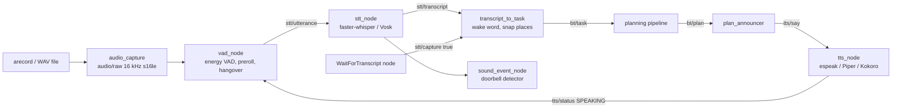

# Audio: speech in, speech out



* **Mute while speaking.** The VAD ignores audio while `tts/status` is SPEAKING plus `mute_tail_ms` (400 ms), so the robot does not hear itself.
* **Answers are not tasks.** `WaitForTranscript` sets the latched `stt/capture` flag so `transcript_to_task` does not turn the answer into a new `bt/task`.
* **Doorbell.** `sound_event_node` detects a steady tone (`audio/events` `{"kind": "doorbell"}`); `DetectSound` waits for it. Tuned on synthetic tones only.

## Engines

| Stage | Engine | Notes |
|---|---|---|
| STT | `faster_whisper` | default model `base.en`, `compute_type: int8` on CPU; gets an `initial_prompt` built from `places.yaml` (hint) |
| STT | `vosk` | offline; ignores hints |
| STT | `mock` | tests the plumbing only |
| TTS | `espeak` | works out of the box (use `-w file` without `-q` for files) |
| TTS | `piper` | `pip install piper-tts` plus a voice `.onnx` (`piper_model`) |
| TTS | `kokoro` | `pip install kokoro-onnx` plus model and voices files; `voice` is required |

Neither STT engine is installed by default; the node refuses to start without one. Install with `pip install faster-whisper` or `vosk`.

## Vocabulary hints and fuzzy matching

Speech-to-text mis-hears place names ("kitchen" as "chicken"). Two cheap fixes, no training (`stt_pipeline/vocab.py`):

1. `stt_node.hint_places` (default true) gives faster-whisper an `initial_prompt` listing the place names from `places.yaml`.
2. `transcript_to_task.snap_places` (default true) replaces a heard word that is close (difflib ratio) to a known place with the exact name.

Measuring the real word error rate needs about 100 recordings from the real microphone (not done).

## Wake word

`transcript_to_task_node.wake_word: robot` (default empty = every transcript is a task):

* "robot, go to the door" -> the task is "go to the door".
* A bare "robot" arms the gate: the **next** utterance within `wake_window_sec` (8 s) becomes the task.
* Anything else is ignored.

## Commands

```bash
ros2 launch framework_bringup audio.launch.py                               # capture + VAD + STT + TTS
ros2 launch framework_bringup audio.launch.py enable_stt:=false             # TTS only (Speak needs tts_node)
ros2 launch framework_bringup audio.launch.py tts_engine:=kokoro tts_voice:=<voice> \
    kokoro_model:=kokoro-v1.0.onnx kokoro_voices:=voices-v1.0.bin
ros2 launch framework_bringup framework.launch.py enable_audio:=true wake_word:=robot
ros2 service call /tts/speak audio_msgr/srv/Speak "{text: 'hello', voice: '', blocking: true}"
```

Audio parameters are in [Parameters](parameters.md). Verified with a synthesized WAV and the mock engines; real recognition, neural TTS playback and live microphone capture are not verified.
