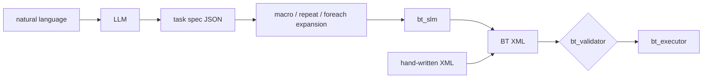

# Behaviour trees, macros and the task lifecycle

## Two ways in



Hand-written trees skip the LLM but **not** the validator:

```bash
ros2 run bt_validator validate_bt --list-nodes          # every node + ports you may use
ros2 run bt_validator validate_bt my_tree.xml           # check offline, readable errors
ros2 run bt_orchestrator submit_bt my_tree.xml --run    # validate -> bt_executor (dry-run unless dry_run:=false)
```

## A complete example

```xml
<root BTCPP_format="4" main_tree_to_execute="Main">
  <BehaviorTree ID="Main">
    <Sequence>
      <Fallback>
        <RetryUntilSuccessful num_attempts="3">
          <NavigateToPlace place="door"/>
        </RetryUntilSuccessful>
        <Speak text="I could not reach the door"/>
      </Fallback>
      <Speak text="Hello"/>
    </Sequence>
  </BehaviorTree>
</root>
```

Examples shipped in `framework_bringup/behavior_trees/`: `greet_person.xml` (detect a person, `ExtractFaceFeature out_identity="{who}"`, `Speak "Hello {person}"`) and `enroll_person.xml` (`EnrollFace`). `Speak` needs `tts_node` (`audio.launch.py enable_stt:=false`); `EnrollFace` and `ExtractFaceFeature` need `face_recognition_node`.

## Authoring rules worth knowing

* Port names `name` and `ID` are reserved by BehaviorTree.CPP and rejected.
* Port values are strings. `{x}` reads the blackboard; an `out_<name>="{x}"` port writes it. `Speak` only substitutes `{person}`, so to say a variable use `text="I heard {person}" person="{heard}"`.
* **Polling:** `RetryUntilSuccessful` retries immediately. Poll a condition as `Fallback(Sequence(cond, ...), ForceFailure(Sleep msec=200))`.
* **Concurrency:** a `Parallel` cannot start two nodes of the same extension; each extension runs one Action at a time.
* A condition may only return RUNNING if it is action-derived; extension nodes are registered as actions.
* In dry-run no node runs, so no output is produced (the downstream port is omitted).

## Macros

`param/macros.yaml` holds 37 named, parameterised step lists, all callable by the LLM (the `whitelist:`). A macro may call other macros but cannot use `foreach`. Add your own by adding an entry with `example_args` and a name in `whitelist:`; `test_macro_library.py` expands and validates it against the real catalog. The generated reference is [Macros](macros.md); the grammar is the [task spec grammar](task-spec-grammar.md).

Some macros worth knowing: `go_to_place`, `go_and_say`, `announce_and_go` (speak while driving, a `Parallel`), `patrol`, `wander`, `follow_person`, `meet_guest`, `receive_guest`, `scout_room`, `report_object`, `describe_person`, `return_home`, `hric_round` (about 100 nodes after expansion, which is why the validator's `max_nodes` is 160).

## Task lifecycle

`task/state` (latched JSON) follows `planning -> ready -> running -> done | failed | halted`, with `repairing` between a failed run and the next attempt. The full state machine, the recovery table and the robot-mode rules are in [Robot mode and recovery](robot-mode-and-recovery.md). With `bt_orchestrator.max_repairs > 0` a failed run goes through the policy (retry, replan through the LLM with the failing node, go home, ask a human, abort); the default is 0.

Every Action and Condition in the LLM's node list is tagged `sync` or `async`, derived from how `bt_executor` really runs it.

## Rule generator vs SLM

The rule-based generator is exact for every spec in the grammar and measured at 0.06 ms against about 1.5 s for the fine-tuned 230M model on a GTX 1650, so `bt_slm` tries the rules first and the model only handles retries or specs the rules cannot render. The grammar covers sequence/fallback/parallel groups with retries, repeat, foreach and macros; SubTree planning and blackboard planning by the LLM are not part of it.
