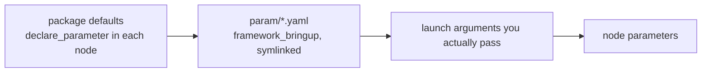

# Configuration, launch files and build

## Where settings live



Precedence, low to high: **package defaults < `param/*.yaml` < launch arguments you pass**. Arguments you do not pass use a sentinel so they never clobber the files. Edit a YAML and relaunch; no rebuild is needed because `framework_bringup` data files are symlinked. Use another folder with `params_dir:=/path/to/my_param`. The real files, comments included, are in [Parameters](parameters.md).

`ros2 run framework_bringup check_params` starts every node with these files and reports **typo'd keys and wrong types**, which ROS would otherwise ignore silently. Run it after every edit.

| File | Configures |
|---|---|
| `pipeline.yaml` | `llm_bridge_node`, `bt_slm_node`, `bt_validator_node`, `orchestrator_node`, `scene_summarizer_node`, `robot_mode_node`, `bt_executor_node` |
| `perception.yaml` | the three YOLO11 nodes and the image source |
| `extensions.yaml` | odom, pid, social, nav, arm, pose extensions, mux, guards |
| `audio.yaml` | capture, VAD, sound events, STT, wake word, TTS, plan announcer |
| `llama_server.yaml` | the managed `llama-server` |
| `navigation.yaml`, `nav2_params.yaml`, `slam_toolbox.yaml`, `cartographer/`, `rtabmap.yaml`, `realsense.yaml`, `nav_sim.yaml`, `places.yaml` | navigation stack and the sample map |
| `cluster.yaml`, `cluster_jobs.yaml` | scheduler, agents and the job catalog |
| `macros.yaml`, `llm_knowledge.md` | macros and what the LLM is told |

Per-package `launch/<pkg>.launch.py` files use the package's own `config/` defaults, **not** `param/`.

## Launch files

| Entry point | Starts | Arguments |
|---|---|---|
| `framework.launch.py` | everything (perception, pipeline, extensions, optional audio, sensors, navigation) | all of the below |
| `perception.launch.py` | YOLO11 nodes + scene summariser | `enable_object`, `enable_person`, `enable_face`, `enable_depth_ranging`, `image_topic`, `show` |
| `pipeline.launch.py` | llm_bridge, bt_slm, validator, orchestrator, robot mode, executor | `start_llama_server`, `llama_model`, `llama_hf_repo`, `llama_port`, `llama_url`, `slm_model_path`, `max_attempts`, `dry_run`, `auto_run`, `groot2`, `mode_gate` |
| `extensions.launch.py` | the BT extensions, mux, guards | `enable_arm/pose/odom/pid/social/nav`, `odom_topic`, `cmd_vel_topic`, `cmd_vel_stamped`, `max_linear`, `max_angular`, `persons_topic`, `arm_group`, `arm_ee_link`, `arm_base_frame`, `move_group_action`, `gripper_action` |
| `audio.launch.py` | capture, VAD, STT, TTS, announcer | `enable_stt`, `enable_tts`, `announce_plans`, `audio_source`, `audio_device`, `audio_file`, `stt_engine`, `stt_model`, `wake_word`, `tts_engine`, `tts_voice`, `piper_model`, `kokoro_model`, `kokoro_voices`, `playback_device` |
| `navigation.launch.py` | Nav2 + SLAM + RealSense | `slam`, `map`, `initial_pose`, `planner`, `navigation`, `use_sim_time`, `publish_static_tf`, `rtabmap_new_map` |
| `nav_sim.launch.py` | 2D simulator + Nav2, no robot | `map`, `start_x/y/yaw`, `odom_slip`, `slam`, `initial_pose`, `planner` |
| `cluster.launch.py` | cluster agent or scheduler | `role`, `host_id`, `roles`, `tags`, `scheduler_id` |

The root `launch/` folder holds thin wrappers (`ros2 launch launch/framework.launch.py dry_run:=true`); the real files are in `src/framework_bringup/launch/` and `--show-args` lists every argument. Every runnable package also has its own launch file to start it alone (`ros2 launch bt_validator bt_validator.launch.py`).

## Build

```bash
export PATH=/usr/bin:$PATH; source /opt/ros/jazzy/setup.bash        # system Python first (a ~/pyvenv.cfg can hide system packages)
colcon build --symlink-install && source install/setup.bash          # or: source env.sh after a build
```

* Python edits need `colcon build` again: `ament_python` copies `.py` files into `install/` even with `--symlink-install` (CMake data files such as `param/` and `launch/` are symlinked).
* Try experimental builds without touching the shared install: `colcon build --build-base B --install-base I --packages-select X`, then `source I/setup.bash` on top.
* `./setup.sh` steps: `apt rosdep python llamacpp models build` (+ optional `slm`, `voice`, `slmweights`). Flags: `--dry-run`, `--only`, `--skip`, `--minimal`, `--yes`, `--backend cuda|vulkan|cpu|prebuilt`. Humble: `./setup_humble.sh` (pins from `requirements-lock-humble.txt`).
* Mixed languages: C++ packages are `llm_bridge`, `bt_executor`, `dstar_lite_planner`; everything else is Python or messages.

## Run

```bash
ros2 launch framework_bringup framework.launch.py image_topic:=/camera/image_raw \
    start_llama_server:=true slm_model_path:=/path/to/finetuned-slm
ros2 topic pub --once /bt/task std_msgs/msg/String "{data: 'fetch the cup'}"
ros2 topic echo /bt/plan
ros2 launch framework_bringup framework.launch.py enable_audio:=true wake_word:=robot      # voice (needs an STT engine)
```

## Systemd (optional)

`tools/systemd/` holds restart-always user units (for example `robocup-llm.service`, which runs `llama-server` with `-c 6144 -np 1`). `tools/systemd/install.sh --enable` installs and enables them so the stack survives a reboot. Not enabled by default.
