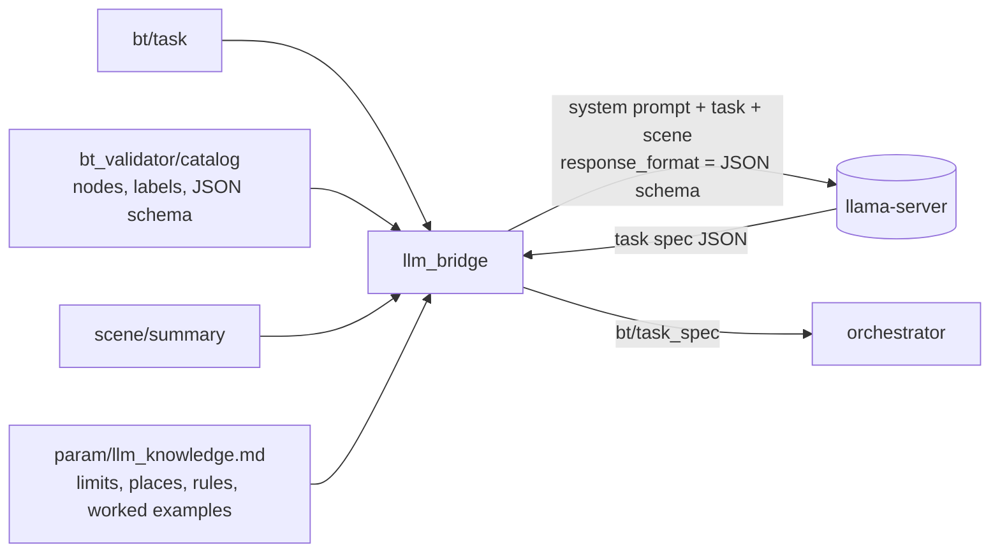
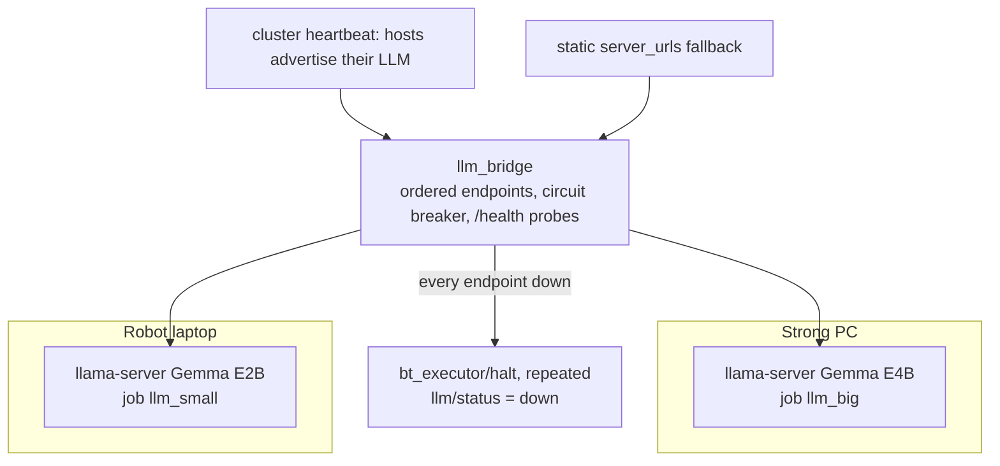

# The LLM link, failover and models

## What the LLM sees and returns



The prompt is about 3.2-3.7k tokens: instructions, the node listing with descriptions, the detector labels, `llm_knowledge.md` (robot limits, places, rules, validated worked examples), the scene, and the task. The reply is **constrained by a JSON schema** built from the live catalog and the macro whitelist, so it can only name real nodes, whitelisted macros and real ports, with string values. Property order in the schema is part of the contract (the bridge uses `ordered_json`).

`llm_knowledge.md` is guarded by a test against the node catalog and `places.yaml`, so an example that names a node or place that does not exist fails CI.

## Endpoints, failover and the emergency halt



| Mechanism | Detail |
|---|---|
| Transport | HTTP over one reused keep-alive TCP connection (libcurl); `connect_timeout_sec` 2 s so a dead host fails fast |
| Auth | `Authorization: Bearer $LLM_API_KEY` when set (variable name configurable via `api_key_env`); the llama-server machine exports `LLAMA_API_KEY`; the key never goes in YAML or argv |
| Ordering | advertised endpoints (priority from the cluster) before static `server_urls` (`static_priority_base` 100); first = preferred |
| Join | a host that advertises an LLM job is used once its `/health` passes |
| Leave | a host silent for `endpoint_ttl_sec` (4 s) is dropped |
| Breaker | `failure_threshold` (2) consecutive failures opens it for `cooldown_sec` (15 s), then the endpoint is probed again |
| JSON retry | `json_retries` (1): re-ask the same endpoint if the reply is not a JSON object |
| Emergency | every endpoint down for longer than `startup_grace_sec` (60 s at boot) -> `halt_service` is called repeatedly and `llm/status` goes `down`; the robot mode node treats it as a missing required signal |
| No usable reply | `llm/error` -> the orchestrator publishes an invalid plan with the reason instead of staying silent |

Verified with fake servers and the real cluster agent and scheduler on one machine, plus a real local llama-server. A second machine was not tried.

## Choosing and running the models

| Role | Model | Where | Notes |
|---|---|---|---|
| LLM, strong | Gemma 4 E4B (`ggml-org/gemma-4-E4B-it-GGUF`) | a PC with a GPU | needs llama.cpp build >= b8637 |
| LLM, robot laptop | Gemma 4 E2B Q4_0 | 4 GB GTX 1650 verified | `-c 6144 -np 1 -ngl 99 --reasoning off` |
| SLM | `LiquidAI/LFM2.5-230M-Base` fine-tuned | CPU is enough | about 1.5 s per spec; rules take 0.06 ms |
| STT | faster-whisper `base.en` or Vosk | CPU | |
| TTS | espeak, Piper, Kokoro-82M | CPU | |

```bash
./setup.sh --only llamacpp,voice --backend prebuilt     # reproduces the verified local setup
llama-server -m models/llm/gemma-4-E2B-it-Q4_0.gguf --host 127.0.0.1 --port 8081 -c 6144 -np 1 -ngl 99 --reasoning off
```

Why those flags: `-c 6144 -np 1` because four default slots share a 4096 context and truncate a 3.5k prompt; `--reasoning off` because Gemma 4's thinking eats `max_tokens` and the reply is cut off ("not a JSON object"). `llama-server -hf <repo>` downloads into llama.cpp's own cache, not the Hugging Face cache; `setup.sh models` uses that on purpose. The LLM server and SLM training cannot share a 4 GB GPU. For a unit file that survives reboots see `tools/systemd/robocup-llm.service`.

## Macros: shorter output, faster plans

A macro is a named parameterised step list (`param/macros.yaml`; 37 macros, all on the `whitelist:` that the model may call). The LLM writes `{"macro": "go_to_place", "args": {"place": "door"}}` (about 15 tokens) instead of a dozen nodes; the orchestrator expands it before the generator. A test expands and validates every macro against the real node catalog. See [Macros](macros.md) and the [task spec grammar](task-spec-grammar.md).

## The SLM

Rules first (`rules_first`), model on retries. How it is trained and measured: [SLM training](slm-training.md), [SLM benchmark](slm-benchmark.md), [Evaluation](evaluation.md).

## Improving plan quality without training

Edit, in this order: macro and node descriptions, worked examples in `llm_knowledge.md`, rules in the same file, the system prompt, deterministic guards. See [Evaluation](evaluation.md).
