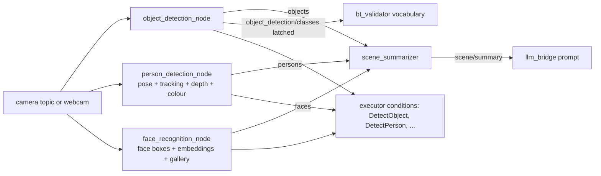

# Perception

Three YOLO11 nodes read the same image source and publish detections; a summariser turns them into a sentence for the planner.



| Node | Publishes | Notes |
|---|---|---|
| `object_detection_node` | `objects` (`ObjectArray`), `object_detection/classes`, `detections/image` | boxes only; labels come from the model's `names` |
| `person_detection_node` | `persons` (`PersonArray`) | `track_id`, COCO-17 keypoints (pose models), `distance_m` (median depth in the torso region), `clothes_colour` |
| `face_recognition_node` | `faces` (`FaceArray`), service `face/enroll` | YOLO11 face detector + YOLO11 embeddings; gallery in `faces/` |
| `scene_summarizer_node` | `scene/summary` | people with distance and gestures, known faces; window 2 s, period 1 s |

`yolo11_common` handles the image source (topic or webcam), model loading and OpenVINO export. Weights `yolo26s.pt` and `yolo26s-pose.pt` download on first use; the face weights (`yolov11n-face.pt`) must be supplied.

## Your own detector (bounding boxes only)

Plain boxes, no segmentation (a 4 GB GPU cannot afford SAM-class models). Measured on a GTX 1650: the nano detector runs about 10 ms per frame (about 95 FPS) in about 100 MiB of VRAM, and a smoke fine-tune at batch 8 / 640 px peaked at 1.6 GB.

```bash
ros2 run object_detection train_detector --data my_items.yaml --base yolo26s.pt --epochs 100   # defaults sized for 4 GB
# param/perception.yaml:  object_detection_node.model: <path to best.pt>
ros2 run bt_slm make_bt_dataset --labels @my_labels.txt --out-dir bt_dataset                   # SLM data with YOUR labels
```

The detector publishes its class names on `object_detection/classes` (latched). The validator then **rejects any `DetectObject label` the model cannot produce**, and the LLM prompt lists those labels plus every usable node. Without a running detector set `bt_validator_node.labels` or use `validate_bt --labels a,b,c`. Never hard-code COCO labels in trees, datasets or prompts. Training needs matplotlib importable; if pip's NumPy 2 and apt's matplotlib clash, `train_detector` says so and `./setup.sh --only python` installs a compatible one.

## Camera rotation (`rotate`)

Every YOLO node has a `rotate` parameter: degrees clockwise (0, 90, 180, 270) that turn **that node's input image** upright. The arm-eye OAK is mounted upside down, so its nodes use `rotate: 180`
(`tools/arm/arm_eye.sh` does this). The boxes and the annotated image are in the **turned** image. Anything that reads the raw depth must turn a detection pixel back first
(`tools/arm/hand_eye.py: raw_pixel`). With a webcam, `raw_topic` republishes the unrotated frames and each reader rotates its own input.

## Depth and distance

`person_detection_node` takes the median depth in the torso region of the box when a depth image is available (RealSense D435): `Person.distance_m` (0 = unknown). `FollowTarget` uses it for a stand-off distance (`distance`, minimum 0.5 m); without depth it falls back to `target_height`, the box height as a fraction of the image.

## Clothes colour

`person_detection/colour.py` (`torso_box`, `clothes_colour`, `colour_name`) names the dominant colour of the torso crop (red, blue, black ...). `DescribePerson` turns it into "a person wearing a red top"; it fails if nobody with a readable colour is in view. Top colour only, tested on synthetic crops.

**Stable person ids (`reid_model` set, off by default).** `person_detection/reid.py` runs an OSNet-AIN ONNX on each person crop and `IdentityBook` replaces the tracker id with a stable one, which a person keeps when they leave and come back (`reid_keep_sec`, 900 s). It stores up to 40 distinct looks per person (reservoir, so old views stay), tagged whole-body or cut-off by the image edge (the two are never compared, and a whole-body look also stores its upper half as a torso look), ignores crops that another person overlaps, and adds the colour of the torso and trousers from the pose keypoints (`parts.py`, `colour_weight` 0.4) to the score. `detections/reid_memory` is a picture of what it remembers; `dump_dir` saves crops for `tools/reid/compare.py`, which scores other backbones on your own recordings. Verified on synthetic data only: no run on real people has measured how often it splits or merges them.

## Gestures

`pose_extension` provides `GetPersonPose`, `IsPersonWaving`, `IsPersonPointing` (direction left/right in image coordinates), `CountPeople`, `FindFreeSeat` (an empty chair/couch/bench in view that no person sits on; needs those labels in the detector) and `DescribePerson`, from the pose keypoints. Rules are tested on synthetic skeletons only.

## Face recognition

`EnrollFace` stores the largest face seen in the last 2 s under a name (A-Z a-z 0-9 _ -); `RecognizeFace` and `ExtractFaceFeature` read `faces`. The greeting flow is `ExtractFaceFeature out_identity="{who}"` then `Speak person="{who}"` (unknown -> "there").

Perception thresholds and models are in [Parameters](parameters.md) (`perception.yaml`). Verified with a fake perception node and synthetic inputs; real camera runs are not done.

## Guest attributes (`DescribeAttributes`, in `pose_extension`)
Says what is visible about the nearest guest's face for the Receptionist: **glasses, hair colour, hat, earrings / necklace** (`out_text` = "wearing glasses and with brown hair"; `out_glasses` yes / no / empty; `out_hair` colour / empty). It cuts a head crop around the biggest confident face (`faces` + `/camera/image_raw`) and runs a face-parsing model (YOLO26 semantic segmentation trained on CelebAMask-HQ, 19 classes, `a-ml/yolo26-face`, AGPL-3.0; the data set is research-use). Hair length, style and jackets are NOT attempted: wrong guest information costs marks, so a value below its threshold is left out and the node fails ("nothing certain") instead of guessing.
Model files (committed, so a clone works: `models/face_parsing/yolo26l-sem-celebamaskhq.pt` 36 MB, preferred, and the nano fallback; if missing, download): `mkdir -p models/face_parsing && cd models/face_parsing && curl -LO https://huggingface.co/a-ml/yolo26-face/resolve/main/checkpoints/yolo26l-sem-celebamaskhq.pt` (the nano `yolo26n-sem-...` is the fallback). Checkpoints are pickles: this one only references torch / ultralytics classes (scanned); scan any other one before loading. The first call loads the model (~2 s on the RTX 3080), later ones take milliseconds.
Tested on one public photo (grey hair, no glasses: right; a bald, turned face: "nothing certain"). NOT tested: real guests, venue light, glasses, hats, earrings, other hair colours; the thresholds and the hair-colour rules in `attributes.py` are first guesses. No macro uses the node yet (`hric_round` could speak it after `meet_guest`; changing macros means re-running the LLM / dataset checks).

## Model weights committed to git (so `git clone` is enough for perception)
`yolo26s.pt` (objects), `yolo26s-pose.pt`, `yolo26n-cls.pt` (face embedding) from Ultralytics (AGPL-3.0); `yolo26s-face.pt` from `akanametov/yolo-face` release 1.0.0 (GPL-3.0); `models/face_parsing/yolo26{l,n}-sem-celebamaskhq.pt` from `a-ml/yolo26-face` (AGPL-3.0, trained on CelebAMask-HQ, which is research-use data). They are added with `git add -f` (`*.pt` and `models/` are ignored on purpose); the repository itself is Apache-2.0, so check these terms before any use beyond the competition. Too big for git (over 100 MB a file) and still fetched by `setup.sh`: Whisper large-v3-turbo (1.5 GB), Kokoro / Piper voices, the Gemma GGUF (4.3 GB), the SLM base model.


## Gender, age, hand sign, bag colour (2026-11-28)
- **`EstimateGender`** (pose_extension): man / woman, he / she and about how old, from the biggest face, voted over three looks; says nothing when the looks disagree. The model is InsightFace's `genderage.onnx`
  (1.3 MB, `models/genderage/genderage.onnx`, downloaded from `huggingface.co/public-data/insightface/resolve/main/models/buffalo_l/genderage.onnx`; the weights are for NON-COMMERCIAL research use). Accuracy on this camera is
  unmeasured; the face is cropped as a square 1.5x its box, not landmark-aligned. Used by `receive_guest` (introductions say he / she, the description says gender and age) and `mates_visit`.
- **Stop sign:** `WaitForStop` counts a raised hand (wrist more than half a shoulder width above the shoulder) held for a second, while the followed person stands still. It does NOT count fingers: body keypoints only give the wrist.
  For a real five-finger check the usable route is the OpenCV zoo's MediaPipe hand models in ONNX (`opencv/palm_detection_mediapipe` and `opencv/handpose_estimation_mediapipe` on Hugging Face; palm detection, then 21 hand
  landmarks; a finger is extended when its tip is further from the wrist than its knuckle). Not wired in yet.
- **Bags:** type = the detector class (backpack, handbag, suitcase; a grocery bag with handles usually comes out as handbag); colour = `dominant_colour` of the middle of the bag's box.
