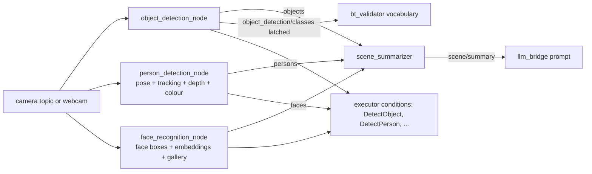

# Perception

Three YOLO11 nodes read the same image source and publish detections; a summariser turns them into a sentence for the planner.



| Node | Publishes | Notes |
|---|---|---|
| `object_detection_node` | `objects` (`ObjectArray`), `object_detection/classes`, `detections/image` | boxes only; labels come from the model's `names` |
| `person_detection_node` | `persons` (`PersonArray`) | `track_id`, COCO-17 keypoints (pose models), `distance_m` (median depth in the torso region), `clothes_colour` |
| `face_recognition_node` | `faces` (`FaceArray`), service `face/enroll` | YOLO11 face detector + YOLO11 embeddings; gallery in `faces/` |
| `scene_summarizer_node` | `scene/summary` | people with distance and gestures, known faces; window 2 s, period 1 s |

`yolo11_common` handles the image source (topic or webcam), model loading and OpenVINO export. Weights `yolo11n.pt` and `yolo11n-pose.pt` download on first use; the face weights (`yolov11n-face.pt`) must be supplied.

## Your own detector (bounding boxes only)

Plain boxes, no segmentation (a 4 GB GPU cannot afford SAM-class models). Measured on a GTX 1650: the nano detector runs about 10 ms per frame (about 95 FPS) in about 100 MiB of VRAM, and a smoke fine-tune at batch 8 / 640 px peaked at 1.6 GB.

```bash
ros2 run object_detection train_detector --data my_items.yaml --base yolo11n.pt --epochs 100   # defaults sized for 4 GB
# param/perception.yaml:  object_detection_node.model: <path to best.pt>
ros2 run bt_slm make_bt_dataset --labels @my_labels.txt --out-dir bt_dataset                   # SLM data with YOUR labels
```

The detector publishes its class names on `object_detection/classes` (latched). The validator then **rejects any `DetectObject label` the model cannot produce**, and the LLM prompt lists those labels plus every usable node. Without a running detector set `bt_validator_node.labels` or use `validate_bt --labels a,b,c`. Never hard-code COCO labels in trees, datasets or prompts. Training needs matplotlib importable; if pip's NumPy 2 and apt's matplotlib clash, `train_detector` says so and `./setup.sh --only python` installs a compatible one.

## Depth and distance

`person_detection_node` takes the median depth in the torso region of the box when a depth image is available (RealSense D435): `Person.distance_m` (0 = unknown). `FollowTarget` uses it for a stand-off distance (`distance`, minimum 0.5 m); without depth it falls back to `target_height`, the box height as a fraction of the image.

## Clothes colour

`person_detection/colour.py` (`torso_box`, `clothes_colour`, `colour_name`) names the dominant colour of the torso crop (red, blue, black ...). `DescribePerson` turns it into "a person wearing a red top"; it fails if nobody with a readable colour is in view. Top colour only, tested on synthetic crops.

## Gestures

`pose_extension` provides `GetPersonPose`, `IsPersonWaving`, `IsPersonPointing` (direction left/right in image coordinates), `CountPeople`, `FindFreeSeat` (an empty chair/couch/bench in view that no person sits on; needs those labels in the detector) and `DescribePerson`, from the pose keypoints. Rules are tested on synthetic skeletons only.

## Face recognition

`EnrollFace` stores the largest face seen in the last 2 s under a name (A-Z a-z 0-9 _ -); `RecognizeFace` and `ExtractFaceFeature` read `faces`. The greeting flow is `ExtractFaceFeature out_identity="{who}"` then `Speak person="{who}"` (unknown -> "there").

Perception thresholds and models are in [Parameters](parameters.md) (`perception.yaml`). Verified with a fake perception node and synthetic inputs; real camera runs are not done.
