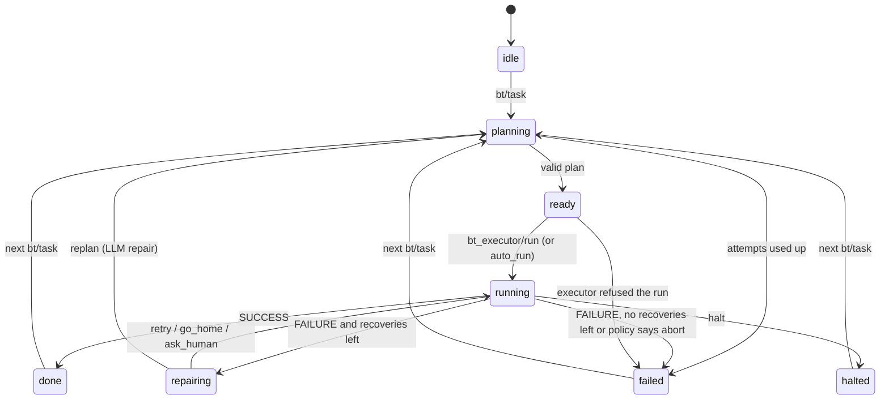
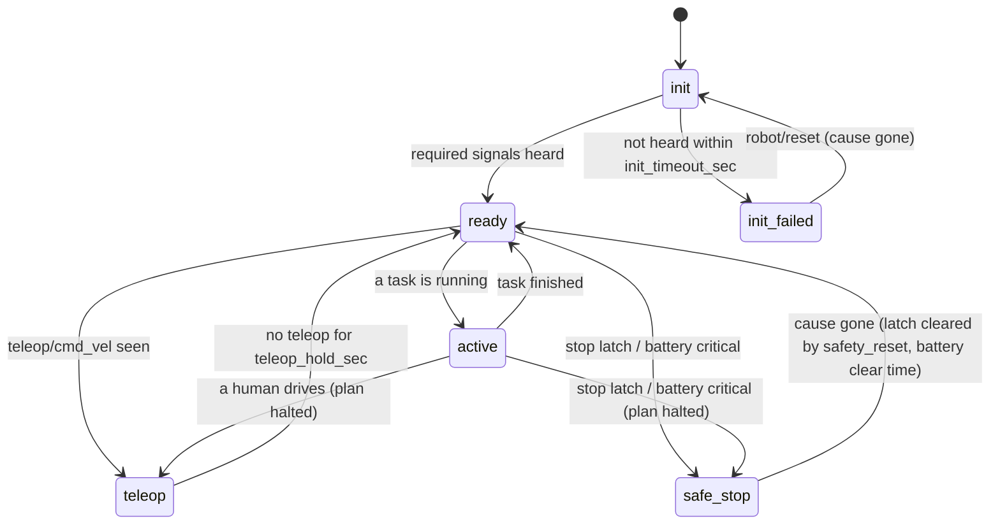

# Robot mode, recovery and mission policy

Three layers sit above a single behaviour tree. Each is a small pure-logic class with real-node tests, so you can read and change the policy without ROS.

| Layer | Class | Question it answers | Output |
|---|---|---|---|
| Task | `TaskFsm` (`task_fsm.py`) | where is this task in its life? | `task/state` |
| Robot | `ModeFsm` (`mode.py`) | is the robot allowed to act at all? | `robot/mode` |
| Recovery | `RecoveryPolicy` (`mode.py`) | the run failed, what now? | an action for the orchestrator |

## Task lifecycle

`max_repairs` (orchestrator parameter, default 0 = no recovery) is how many recoveries one task may use; a new user task resets the count. `done`, `failed` and `halted` stay until the next `bt/task`. A hand-written tree submitted mid-run does not change the lifecycle.

## Robot mode

| Mode | Meaning | `run_ok` |
|---|---|---|
| `init` | waiting for the required signals (default `executor`, `llm`; add `scan` on the real robot) | no |
| `init_failed` | a required signal missing after `init_timeout_sec` (60 s) | no |
| `ready` | idle and allowed to act | yes |
| `active` | a task is running | yes |
| `teleop` | a human is driving; any running plan was halted | no |
| `safe_stop` | bumper/cliff latch (from the mux) or a critical battery; a running plan is halted | no |

Inputs (`robot_mode_node` subscribes): `safety/stop_state`, `safety/battery`, `teleop/cmd_vel`, `task/state`, `llm/status`, `/scan`, and the executor's `bt_executor/halt` service becoming ready ("executor heard"; `bt/status` is published once per run, so it cannot signal readiness). It publishes `robot/mode` (latched JSON, every 0.5 s) and serves `robot/reset`. Reset is refused while a hazard is still present: clear the bumper first with `safety_reset`.

**Mode gate.** With `bt_executor_node.mode_gate: true` (off by default) `bt_executor/run` and `auto_run` refuse unless a `robot/mode` no older than `mode_gate_max_age_sec` (3 s) says `run_ok`. It fails closed: no mode node, or a stale mode, means no run.

**Mission budget.** `mission_budget_sec > 0` starts a clock when a task enters `planning` and halts the run when it expires. 0 disables it.

## Recovery policy

After a failed run the orchestrator asks `RecoveryPolicy.decide(result, failed_node, used)`:

| Failed node starts with | 1st | 2nd | 3rd | then |
|---|---|---|---|---|
| `NavigateTo`, `DriveDistance`, `RotateBy`, `FollowTarget` | retry | replan | go_home | abort |
| `Detect`, `Find`, `Recognize`, `Count`, `Describe`, `IsPerson`, `GetPerson` | retry | replan | ask_human | abort |
| `WaitFor`, `Listen`, `Extract` | retry | ask_human | | abort |
| anything else | replan | ask_human | | abort |

Result overrides: `ERROR...` or `HALTED` is always `abort` (a crashed tree or a human stop must not trigger more motion); `TIMEOUT` is `go_home` once, then abort.

| Action | What the orchestrator does |
|---|---|
| `retry` | start the same plan again (`bt_executor/run`; retried up to 8 times if the executor is still finishing) |
| `replan` | publish the failure on `bt/repair`; the LLM writes a new spec, the normal planning loop runs |
| `go_home` | publish a fixed spec (`return_home`) and run it, no LLM |
| `ask_human` | publish a fixed spec that says "I could not finish: <detail>. Please help me." and run it |
| `abort` | task `failed` |

The table is a starting point (`shortcut:` in the code): tune it with real runs, and replace it with a per-task table only when it stops being enough.

## Tested

| Test | What it proves |
|---|---|
| `test_mode.py`, `test_task_fsm.py` | the state machines and the table, pure logic |
| `tools/integration/mode_test.py` | real nodes: gate refuses without a mode, bumper latch gives `safe_stop` and halts, reset behaviour |
| `tools/integration/recovery_test.py` | a **live executor** with fake extensions that fail on command: A retry after one blocked goto, B retry then replan then go_home, C retry then replan then ask_human (the sentence is spoken) |

Not tried on a real robot.
