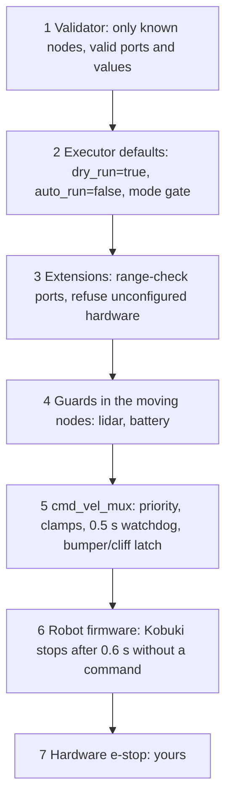

# Safety

> [!CAUTION]
> The software mux is a gate, not an emergency stop. Keep a hardware e-stop within reach on every real run, and never pass `dry_run:=false` without a person at it.

The planner is not trusted with safety. Every protection sits in the code that moves the robot, in layers, and the defaults are conservative. **None of this replaces a hardware emergency stop.** The software mux is a gate, not an e-stop; keep a hardware stop within reach on every real run.

## The layers

## 1. Dry-run and manual run

`framework.launch.py` starts `bt_executor` with `dry_run: true`: extension nodes are only logged and report success; nothing moves. To command hardware you must pass `dry_run:=false`. Even then a valid plan waits for `ros2 service call /bt_executor/run std_srvs/srv/Trigger` unless you pass `auto_run:=true`. `ros2 service call /bt_executor/halt std_srvs/srv/Trigger` stops the tree and cancels the running extension goal. `max_runtime_sec` (300) bounds a run.

## 2. Mode gate

With `mode_gate:=true` the executor refuses `run` and `auto_run` unless a `robot/mode` no older than 3 s says `run_ok` (see [Robot mode and recovery](robot-mode-and-recovery.md)). It fails closed: no mode node means no run. It is off by default so a bare executor still works for development.

## 3. The velocity mux (`cmd_vel_mux_node`)

All motion goes through one gate in front of the robot:

| Behaviour | Detail |
|---|---|
| Priority | `teleop` > `odom_extension` > `pid_extension` > `nav2` (a lower priority is ignored while a higher one is fresh) |
| Clamp | `max_linear` and `max_angular` hard limits (0.3 m/s linear by default) |
| Watchdog | a zero Twist is sent when no input arrives for `timeout_sec` = 0.5 s, then once when all sources go stale; a crashed extension coasts at most about 0.5 s at its last command |
| Latch | Kobuki bumper or cliff events latch the mux to zero; `safety_reset` clears it and is **refused while a sensor is still hit** |
| State | `safety/stop_state` = `armed` or `latched: <reason>`; the robot mode node turns a latch into `safe_stop` and halts the plan |

Sim-verified only: `tools/integration/stop_latch_test.py`.

## 4. Guards in the moving nodes

| Guard | Rule | Where |
|---|---|---|
| Lidar clearance | `DriveDistance` and `NavigateTo` stop at 0.30 m; `FollowTarget approach` stops at 0.40 m | `ScanGuard` in `odom_extension`, `pid_extension` |
| Rotation clearance | `RotateBy` refuses to turn with anything within 0.22 m | same; set `scan_required: true` on the real robot so a missing scan refuses instead of allowing |
| Battery | `battery_guard_node` halts the plan when the Kobuki battery is below 13.2 V for 3 s (not charging), repeating while it stays low; publishes `{"level": "critical"}` on `safety/battery` | thresholds 14.0 V low / 13.2 V critical are the Kobuki driver's documented defaults, **not measured** on this robot |
| LLM outage | if every LLM endpoint is down the bridge calls `bt_executor/halt` repeatedly and `llm/status` goes `down` | `llm_bridge` (60 s grace at boot) |
| No arm | tasks that need an arm (carry, fetch, open, pour ...) are refused when no arm is configured, with a spoken refusal | `bt_orchestrator/policy.py` (a regex heuristic) |
| Arm | `arm_extension` refuses to move until `arm_group`, `arm_ee_link`, `arm_base_frame` and `gripper_action` are set; velocity scale is capped at 0.1 | `arm_extension` |

## 5. Defaults at a glance

| Setting | Default | Why |
|---|---|---|
| `dry_run` | true | nothing moves until you say so |
| `auto_run` | false | a human or script starts each run |
| `mode_gate` | false | opt in for the real robot |
| odom speeds | 0.2 m/s | conservative |
| mux clamp | 0.3 m/s | hard ceiling |
| arm velocity scale | 0.1 | conservative |
| `max_repairs` | 0 | no autonomous recovery unless enabled |

## 6. Before a real run

1. `ros2 run framework_bringup preflight` (key, SROS2, mux, executor dry-run, LLM, `/scan`, TF, clock, disk): fix every FAIL.
2. Rehearse the task in dry-run and read the plan tree on the [dashboard](dashboard.md).
3. Someone at the hardware e-stop; clear space; `scan_required: true`.
4. Enable `mode_gate` and `robot_mode_node`; decide `max_repairs` and `mission_budget_sec`.
5. `dry_run:=false`, run once by hand (`bt_executor/run`), keep a hand on `teleop` (the first key halts the plan).

## Supporting tools

`tools/record_run.sh` (rosbag2), `tools/net/timesync.sh` (chrony for two machines), `tools/systemd/` (restart-always user units; `install.sh --enable` to start at boot), `.flake8` and `requirements-lock.txt` (lint and pinned versions).

## What is not verified

The bumper/cliff latch on a real Kobuki, a real RPLIDAR, the battery thresholds, `scan_required` on the real robot, and any real arm motion. See [Status](status.md).
