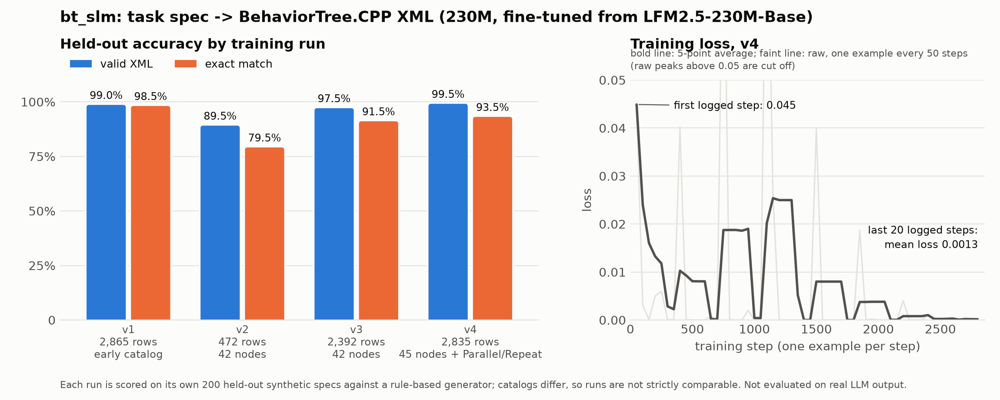

# SLM benchmark (`bt_slm`)

([dark version](img/slm-benchmark-dark.png); data behind it: `slm-benchmark.json`; redraw with `python3 tools/slm/plot_benchmark.py`)

Table view of the left panel:

| Run | Training rows | Catalog | `--max-len` | Valid XML | Exact match |
|---|---|---|---|---|---|
| v1 | 2,865 | early catalog | 1024 | 99.0 % | 98.5 % |
| v2 | 472 | 42 nodes | 512 | 89.5 % | 79.5 % |
| v3 | 2,392 | 42 nodes | 768 | 97.5 % | 91.5 % |
| **v4** (current, `models/bt-slm`) | 2,835 | 45 nodes + Parallel/Repeat | 768 | **99.5 %** | **93.5 %** |

**How to read it**
- *Valid XML* = the validator accepts the generated tree; *exact* = identical to the rule-based generator's tree for the same spec. Each run is scored on
  its own 200 held-out rows of synthetic specs, so the catalogs differ between runs and the bars are **not strictly comparable**.
- It shows the model learned the rules. It does **not** show how it copes with real LLM output, and the rule-based generator runs first anyway
  (`rules_first`): the SLM only handles retries and specs the rules cannot render.
- Why v2 is low: only 472 of 4000 rows fit under 512 tokens (a 4 GB GPU at batch size 1 limits the sequence length). Why v4 uses fewer rows than v1:
  rows are longer now (45-node catalog), so fewer fit under 768 tokens.
- Loss panel: batch size 1, so each logged value is a single example; the bold line is a 5-point average.
- Speed (measured earlier, GTX 1650): rule-based generator 0.06 ms, SLM about 1.5 s per spec.

## v5: long plans ("heavy" and "max heavy")
v4 only saw rows under 768 tokens, so long plans were never trained. v5 continues from v4 on a mix of normal, heavy (5-9 top-level steps, deeper groups) and max
(close to the validator's 64-node limit) specs, up to 2560 tokens. Scored on 20 held-out rows per set (small: differences under about 10 points are noise):

| set | v4 valid / exact | v5 valid / exact |
|---|---|---|
| normal | 1.00 / 0.90 | **1.00 / 1.00** |
| heavy | 0.55 / 0.35 | **0.90 / 0.70** |
| max | 0.80 / 0.50 | **0.90 / 0.80** |

On the usual 200 normal rows, under today's validator: v4 0.970 / 0.935, v5 0.975 / 0.980 (5 of those 200 reference trees are Parallel-on-one-extension, which the validator now rejects, so valid cannot exceed 0.975).
Same caveats as above (synthetic specs, rule-based generator as the reference). Generating a heavy plan on the CPU takes much longer than a normal one (about 2000 tokens),
which is acceptable because the SLM only runs on retries and specs the rules cannot render. Published: v5 is on the public Hugging Face repo `larmkaixian/bt-sim-slm` (older versions stay in the repo history).

Next version: add a row to `slm-benchmark.json` (and the loss points) after each fine-tune, then re-run the plot script.
