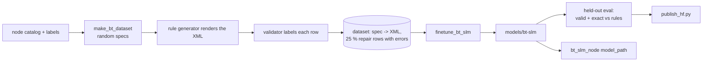

# Training the SLM

The SLM (`LiquidAI/LFM2.5-230M-Base`, fine-tuned) renders a task spec into BehaviorTree XML. Rules run first; the model covers retries and specs the rules cannot render, so training is optional and low-risk. This page is the full recipe, including how to fit a 4 GB GPU.



## 1. Dataset

```bash
ros2 run bt_slm make_bt_dataset --out-dir bt_dataset --n 12000                       # normal plans
ros2 run bt_slm make_bt_dataset --out-dir bt_dataset_v4_heavy --profile heavy --n 2000
ros2 run bt_slm make_bt_dataset --out-dir bt_dataset_v4_max   --profile max   --n 1000
ros2 run bt_slm make_bt_dataset --labels @my_labels.txt --extension-config my_ext.yaml   # YOUR detector classes / nodes
```

| Flag | Default | Meaning |
|---|---|---|
| `--n` | 20000 | rows to generate |
| `--profile` | normal | `normal`, `heavy`, `max`: plan length |
| `--repair-frac` | 0.25 | share of rows that carry a previous XML and validator errors (teaches retries) |
| `--val-frac` | 0.02 | validation share |
| `--labels` | | comma list or `@file`: the detector's classes |
| `--extension-config` | | extra manifest YAML, repeatable |
| `--seed` | 0 | reproducible data |

Profiles (`PROFILES` in `dataset.py`): top-level steps / inner steps / max group depth / group probability.

| Profile | Top steps | Inner steps | Depth | P(group) | Typical size |
|---|---|---|---|---|---|
| normal | 1-5 | 1-3 | 2 | 0.20 | under 768 tokens |
| heavy | 5-9 | 2-5 | 3 | 0.35 | median about 1.4k tokens |
| max | 9-14 | 3-6 | 4 | 0.40 | up to 3.8k tokens, near the 64-node limit |

Every row is **validator-labelled**: the rule generator renders it and `validate_xml` must accept it, so the model is only ever taught valid trees. The prompt format is fixed (`bt_slm/prompt.py`, `prompt_for`) and a test rebuilds training prompts the way inference does; changing it means regenerating data and retraining.

## 2. Fine-tune

```bash
PYTHONUNBUFFERED=1 ros2 run bt_slm finetune_bt_slm \
  --data-dir bt_dataset_v4_normal:150,bt_dataset_v4_heavy:500,bt_dataset_v4_max:250 \
  --base models/bt-slm-v4 --out models/bt-slm-v5 \
  --max-len 2560 --max-new 3072 --optim adafactor --lr 2e-5 --grad-ckpt --batch-size 1 --epochs 1
```

| Flag | Default | Use |
|---|---|---|
| `--data-dir a:N,b:N` | `bt_dataset` | mix datasets, taking the first N rows of each |
| `--base` | LFM2.5-230M-Base | start from the base or continue from a previous fine-tune |
| `--max-len` | 1536 | rows longer than this are dropped (memory limit) |
| `--optim` | adamw | `adafactor` keeps almost no optimiser state |
| `--grad-ckpt` | off | gradient checkpointing: slower, long rows fit |
| `--batch-size`, `--lr`, `--epochs` | 8, 5e-5, 3 | on 4 GB use batch 1 |
| `--eval-n`, `--max-new` | 200, 1024 | held-out rows scored, tokens the eval may generate (heavy plans need 3000+) |

### What fits on a GTX 1650 (4 GB)

* Normal rows with `--max-len 768`, batch 1, AdamW: works (about 50 minutes for 2.8k rows).
* Rows up to 2560 tokens: AdamW with fp32 does **not** fit even with checkpointing; Adafactor + `--grad-ckpt` does (about 3 s per step at 2048 tokens, about 40 minutes for 900 rows).
* `llama-server` and training cannot share the GPU: stop the server first.
* Stdout of a backgrounded run is block-buffered: use `PYTHONUNBUFFERED=1`, otherwise it looks stuck. Watch it with `tail -f` on the log file; a log line is written every 10 steps.
* `PYTORCH_CUDA_ALLOC_CONF=expandable_segments:True` helps fragmentation.

## 3. Score

The fine-tune script evaluates on held-out rows against the rule generator: **valid** = the validator accepts the model's tree, **exact** = identical to the rule tree. Results so far are in [SLM benchmark](slm-benchmark.md). Remember the caveat: it proves the model learned the rules, not that it handles real LLM output.

| Version | Held-out normal valid / exact | Heavy | Max |
|---|---|---|---|
| v4 | 1.00 / 0.90 | 0.55 / 0.35 | 0.80 / 0.50 |
| v5 | 1.00 / 1.00 | 0.90 / 0.70 | 0.90 / 0.80 |

## 4. Use and share

```bash
ros2 launch framework_bringup framework.launch.py slm_model_path:=$PWD/models/bt-slm
```

`max_new_tokens` in `bt_slm.yaml` must cover the longest plan (3072 after v5). To publish: add a row to `docs/slm-benchmark.json`, run `tools/slm/plot_benchmark.py`, then `tools/slm/publish_hf.py --model models/bt-slm --repo <you>/<name> --valid .. --exact ..` (private unless `--public`; **updating a public repo is public immediately**). The card is neutral on purpose (no project name or links); check the weights for identifying strings before publishing. The base model's LFM Open License requires shipping the license and marking the files modified; commercial use is restricted above 10 M USD revenue.

## Training the LLM instead?

Not needed so far: the GPSR-style misses were fixed by macro descriptions, worked examples and prompt rules, which are cheap and reversible ([Evaluation](evaluation.md)). If misses persist, the plan is a QLoRA fine-tune of Gemma E2B on a free Colab T4 using the gold plans in `tools/gpsr/commands.py` (never on the 4 GB laptop); Gemma 4 support in peft/trl and adapter conversion are untested.
