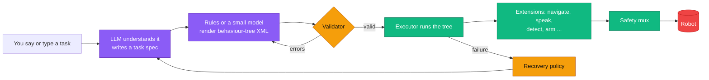

# Start here

A guided path for someone who has never seen this project. Read the pages in order; each one ends with where to go next. You do **not** need a robot, a GPU or an LLM for the first four steps.

## What this is, in one minute

You tell the robot something in plain language ("go to the door and say hello"). The framework turns that into a **behaviour tree**, a small program the robot can execute, **checks it** against what the robot can really do, and only then runs it. If something fails halfway, a recovery policy decides whether to retry, re-plan, go home or ask a human.

## The learning path

| Step | Page | You will know afterwards | Needs |
|---|---|---|---|
| 1 | [Concepts and glossary](concepts-and-glossary.md) | the words used everywhere else | nothing |
| 2 | [Tutorial: first plan](tutorial-first-plan.md) | how to build, run a plan in dry-run, and read what happened | a Linux PC with ROS 2 |
| 3 | [Architecture](architecture.md) | what every box does and why it exists | nothing |
| 4 | [Task spec grammar](task-spec-grammar.md), [Macros](macros.md), [BT node catalog](node-catalog.md) | what you (or the LLM) may write | nothing |
| 5 | [Validator rules](validator-rules.md) | why a plan is rejected and how to fix it | nothing |
| 6 | [Operator guide](operator-guide.md), [Dashboard](dashboard.md) | every command you type while running the robot | a running stack |
| 7 | [Safety](safety.md), [Robot mode and recovery](robot-mode-and-recovery.md) | what stops the robot and what happens after a failure | nothing |
| 8 | [LLM and models](llm-and-models.md), [Evaluation](evaluation.md), [SLM training](slm-training.md) | how plans are produced, measured and improved | a GPU for training |
| 9 | [Writing an extension](writing-an-extension.md), [Perception](perception.md), [Navigation](navigation.md), [Audio](audio.md) | how to add your own robot skills | your hardware |
| 10 | [Cluster](cluster.md), [Workspaces and security](workspaces-security.md) | running on several machines, securely | a second machine |
| 11 | [Testing and CI](testing-and-ci.md), [Troubleshooting](troubleshooting.md), [FAQ](faq.md) | how it is tested, and what to do when it breaks | nothing |

Reference pages you will keep open: [Interfaces](interfaces.md), [Messages](messages.md), [Parameters](parameters.md), [BT node catalog](node-catalog.md).

## What is real and what is not

> [!IMPORTANT]
> Everything here is tested in simulation and CI. Nothing has run on a real robot, arm, second machine or real microphone audio.

Be clear about this before you rely on anything: everything here is tested **in simulation and CI**. It has **not** been run on a real robot, a real arm, a second machine or real microphone audio. [Status](status.md) lists exactly what was verified. Keep a hardware e-stop within reach; the software mux is not one.
