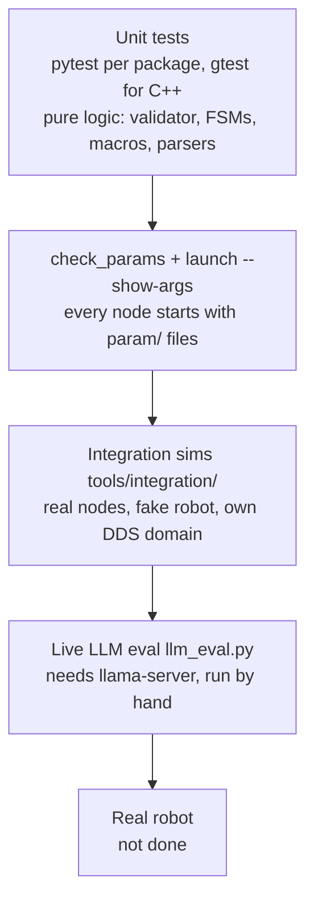

# Testing and CI

Everything is tested without hardware first. The CI badge on the README is the `ci` workflow (`.github/workflows/ci.yml`); it has two jobs.

| Job | Container | What it does |
|---|---|---|
| `build-test` | ROS 2 Jazzy | full build, unit tests, gtests, `check_params`, launch-file parsing, lint and every integration sim below |
| `build-test-humble` | `ros:humble` | rosdep, build, `colcon test` (unit tests only; the sims run on Jazzy) |

## Test layers



## Unit tests

```bash
source env.sh
colcon test --packages-select bt_validator bt_slm bt_orchestrator && colcon test-result --verbose
python3 -m pytest src/bt_validator/test -q          # one package
```

Notable suites: `test_validate.py` (every rule), `test_macro_library.py` (every macro expands and validates against the real catalog), `test_gpsr_commands.py` (gold plans validate), `test_mode.py` / `test_task_fsm.py` (policies), `test_fallback.py` (retry path), `test_dataset.py` (profiles), `test_vocab.py` (STT hints), `test_colour.py` (clothes colour), C++ gtests for `llm_bridge` (including the schema key-order guarantee) and the D* Lite core.

## Integration sims (`tools/integration/`)

Each starts real nodes on its own `ROS_DOMAIN_ID`, `ROS_AUTOMATIC_DISCOVERY_RANGE=LOCALHOST`, fakes only the outside world, and prints `ok` / `FAIL` / `PASS`.

| Script | Proves |
|---|---|
| `stop_latch_test.py` | bumper/cliff latches the mux; reset refused while a sensor is hit |
| `outputs_test.py` | an extension's `out_*` value reaches the next node through the blackboard |
| `listen_test.py` | `WaitForTranscript` and the `stt/capture` flag |
| `guard_test.py` | lidar guard stops `DriveDistance` for obstacles |
| `rehearsal.sh` | GPSR/HRIC node sequences in dry-run |
| `tree_feed_test.py` | `bt/tree` + `bt/node_status` feed for the dashboard |
| `battery_test.py` | battery guard halts the plan |
| `llm_failover_test.py`, `cluster_llm_test.py`, `transport_test.py` | LLM failover, emergency halt, hosts joining/leaving, TCP reuse, API key accepted/refused |
| `workspace_test.py` | create/discover/join, wrong token refused, SROS2 enforcement, roles, revoke |
| `prompt_test.py` | what the planning LLM actually receives |
| `repair_test.py` | task lifecycle and repair loop |
| `nav_planner_test.py` | Nav2 with the D* Lite plugin in `nav_sim` |
| `itest_task.py`, `itest.sh` | task to simulated robot: live moves, dry-run does not move |
| `mode_test.py` | robot mode, mode gate, latch |
| `recovery_test.py` | retry / replan / go_home / ask_human against a live executor with fake failing extensions |
| `groot2_test.py` | Groot2 port opens, node palette written |

## Writing a trustworthy sim test

* **Own domain, localhost discovery**, never the robot's. `check_params` uses 97; pick a number nobody else uses.
* **Kill in a separate command** and never with a pattern that appears in your own command line (`pkill -f foo` inside a command that contains `foo` kills your shell). Scripts use exit traps.
* **Reset state between scenarios.** The recovery test once passed locally and failed in CI because the previous scenario's final `done` matched the next one's identical goal text; clear the remembered state before each scenario.
* **Do not trust discovery timing.** Join, manifests and latched topics race on a loaded runner: retry or wait for the real readiness signal (the executor's `halt` service, not a message published once).
* A launch file that parses (`--show-args`) proves nothing about behaviour; start the nodes.

## CI hygiene

* Lint is `flake8` with one repo-wide `.flake8`.
* Failed jobs upload logs as artifacts.
* Concurrency is per ref with cancel-in-progress, so a newer push cancels an older run.
* Before relying on a "green": check the run is for the commit you think it is.
