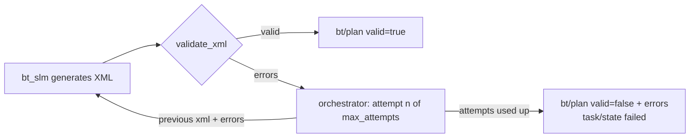

# Validator rules

`bt_validator` (`validate_xml` in `bt_validator/validate.py`) is the gate between planning and execution. It is deterministic and pure: the same XML and catalog always give the same answer. The same function backs the ROS service `bt_validator/validate`, the offline tool `validate_bt` and the SLM training-data labeller, so what the planner is taught is exactly what the executor enforces.

```bash
ros2 run bt_validator validate_bt my_tree.xml                 # offline, readable errors
ros2 run bt_validator validate_bt --list-nodes                # every usable node + ports
ros2 run bt_validator validate_bt --labels cup,bottle my.xml  # without a running detector
```

## What is checked

> [!NOTE]
> The validator is the single source of truth. The LLM schema, the SLM prompt and the executor all derive from the same catalog.

| Area | Rule | Example error |
|---|---|---|
| Document | `<root BTCPP_format="4">`; every `<BehaviorTree>` has a unique `ID`; `main_tree_to_execute` names one | `<root> is missing main_tree_to_execute` |
| Unknown elements | only `BehaviorTree` and `TreeNodesModel`-style elements under root | `unexpected element <x> under <root>` |
| Shape | a control node has at least 1 child; a decorator exactly 1; a leaf none; a `BehaviorTree` exactly 1 root node | `decorator <Inverter> needs exactly 1 child, has 2` |
| Nodes | every tag exists in the core set or in some extension manifest | `unknown node <Fly> (not in core or any extension)` |
| Ports | all required ports present; no unknown port attributes | `<Speak> missing required port 'text'` |
| Values | no empty ports; `{...}` blackboard references must be well formed; numeric ports must be numbers | `port 'min_conf'='>0.5' is not a number` |
| Vocabulary | a port with a closed value set (the detector's labels for `DetectObject` / `CountObjects`) accepts only those values; blackboard refs are exempt | `port 'label'='unicorn' is not a known value (known: cup, ...)` |
| Limits | depth at most `max_depth` (12), nodes at most `max_nodes` (160 in `pipeline.yaml`; the library default is 64) | `tree has 70 nodes, limit is 64` |
| SubTree | target defined, no children, no cycles | `SubTree cycle: A -> B -> A` |
| Concurrency | a `Parallel` must not start two nodes of one extension (an extension runs one Action at a time) | `<Parallel> starts two nodes of extension 'X' at once` |

Numeric ports (`NUMERIC_PORTS`) are `distance, kd, ki, kp, meters, min_conf, pitch, radians, roll, speed, target_height, timeout_ms, ...`; a blackboard reference is allowed there.

## Why these rules exist

Several are scars from real runs:

* **Numbers must be numbers (T-21).** Gemma once wrote `min_conf: ">0.5"`. BehaviorTree.CPP would accept the string and the extension would fail at run time. Now the plan is rejected, the error is fed back, and `llm_knowledge.md` tells the model to write `0.5`.
* **Two nodes of one extension in a `Parallel` (T-25).** The extension's action server rejects the second goal, so the tree failed at run time in a way the plan never showed. It is a validation error now.
* **Unknown nodes on the retry path (T-22).** The retry fallback used to drop steps it did not recognise and could accept a shorter plan. It now raises: `plan uses unknown nodes [...]; refusing to drop them`.
* **Reserved port names.** `name` and `ID` belong to BehaviorTree.CPP; the catalog rejects them when an extension loads.

## How errors travel



`BtPlan.errors` always carries the last attempt's errors, so a failed plan tells you why. An LLM that produced no usable reply gives an invalid plan with the reason (`llm/error`), never silence.

## Adding a rule

Add it to `validate_xml`, add a failing XML to `bt_validator/test/test_validate.py`, and if the rule rejects something old training data contains, expect the SLM's `valid` score on old reference rows to drop (that is what the Parallel rule did: 5 of 200 old reference trees violate it, so `valid` caps at 0.975 on that set).
