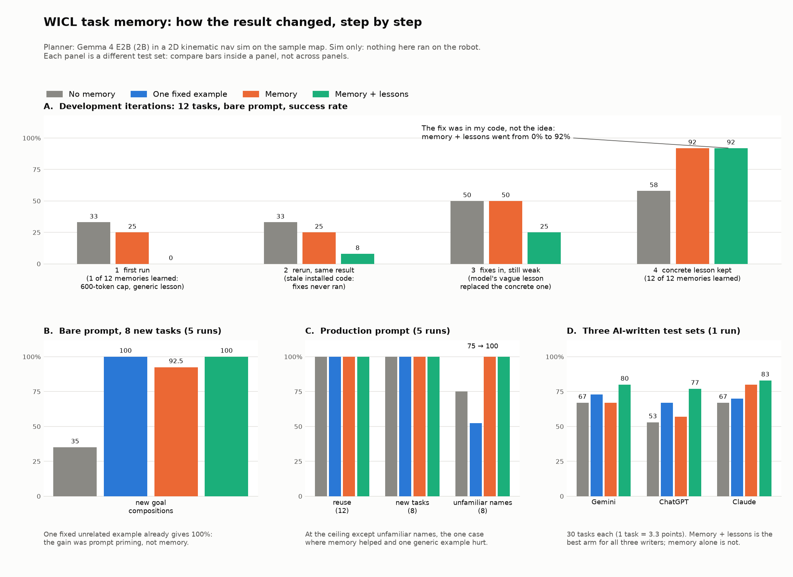
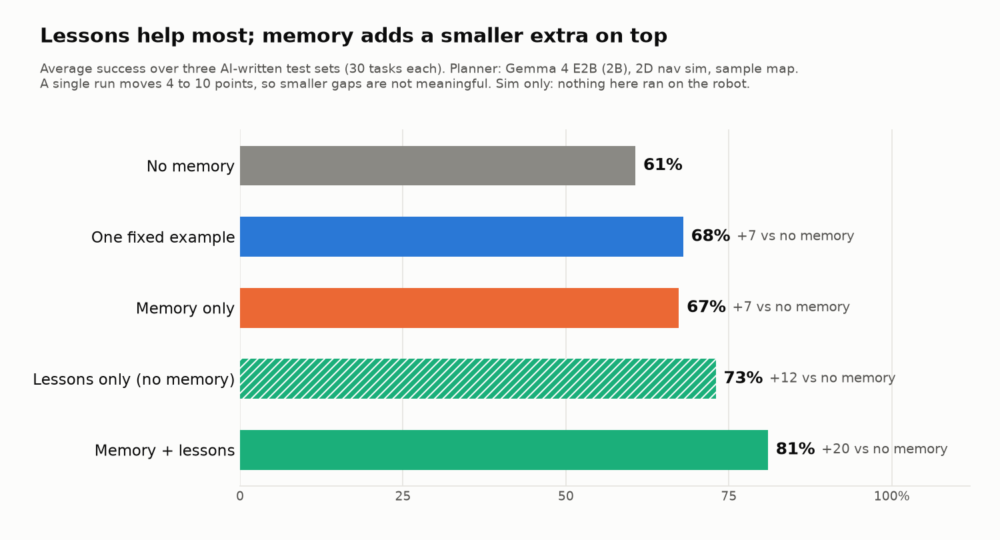

# World In-Context Learning (task memory)

> [!WARNING]
> Sim-verified at most: a **2D kinematic** nav sim (no Nav2, no manipulation physics, no hardware). Off by default.

Based on the idea in Fang et al., *World In-Context Learning for Agentic Robot Manipulation* (arXiv:2611.12885; see [Reference](#reference)). The model never changes: the planner tries a task in a simulator, learns from the feedback **in its context**, and a successful rehearsal is saved as a **Task Memory** (a JSON file). No fine-tuning, no gradient updates. Differences from the paper are in [notes/wicl_paper_notes.md](../notes/wicl_paper_notes.md).

```
rehearse (bt_rehearsal)                    deploy (bt_orchestrator, memory_enabled:=true)
task -> LLM plan -> validator -> sim       task -> look up memories (task text + scene objects)
   fail: reflect, feed lesson back, retry     -> inject top-k as examples for the LLM
   success: freeze as Task Memory   ------>   -> if a memory's XML validates NOW, use it as the plan
```

## Pieces

| Package | Role |
|---|---|
| `bt_memory` | `TaskMemory` (versioned JSON, one file per memory), store, lint, `TextSceneRetriever` (swap-in point for embeddings), cross-embodiment adapter |
| `bt_rehearsal` | `Simulator` protocol, `KinematicNavSim`, rehearsal loop, reflection, `wicl` CLI, `rehearsal_node` |
| `bt_orchestrator` | `memory_hook.py`: retrieval, behind `memory_enabled` (default **false**) |

## Run it

```bash
source env.sh
# rehearse against a llama-server endpoint (no endpoint = offline: reports planner_unavailable, plans nothing)
ros2 run bt_rehearsal wicl rehearse "go to the right room" --goal-place right_room --endpoint http://127.0.0.1:8080
ros2 run bt_rehearsal wicl list
ros2 run bt_rehearsal wicl show <id>
ros2 run bt_rehearsal wicl adapt <id> capabilities.yaml   # new memory for another robot, or a loud error
# deployment: retrieval on (wicl_verbose:=true logs every retrieval: scores, ids, which memory was offered)
ros2 launch framework_bringup pipeline.launch.py wicl_memory:=true wicl_verbose:=true
# ROS services: wicl/rehearse (RehearseTask), wicl/memories (ListMemories); node: ros2 run bt_rehearsal rehearsal_node
```
Memories live in `~/.local/share/robocup_fw/bt_memory` (override with `memory_dir`). Parameters are in `param/pipeline.yaml` (`memory_*`).

## Guarantees and their limits

- **A memory is a proposal.** The orchestrator re-validates its XML against the current validator before using it; a stale one is only shown as an example. `bt_executor` is untouched (dry-run default, validator-approved plans only). The velocity mux, watchdog and guards are not touched.
- **Data isolation.** The simulator returns `Observable` (scene summary, validator errors, executor-style result with failed node) and `Privileged` (pose, extras). `Privileged` has no text form; `Observable` accepts only allow-listed keys; the loop calls the simulator's `score()` for the pass/fail bit and passes nothing else on. A test plants a sentinel in the ground truth and asserts it appears in no prompt and no stored memory. Memories are also linted (no coordinates, no "ground truth").
- **Offline.** Rule generator and SLM are unchanged. With no LLM endpoint, rehearsal degrades (`planner_unavailable`), reflection falls back to a template lesson, and retrieval of existing memories works with no network. 4 GB VRAM: nothing here loads a model; the LLM is whatever endpoint you point at.
- **Not covered.** The kinematic sim models Sequence/Fallback/Retry/Repeat/Sleep/Speak and navigation (grid reachability) only. Any other node fails with "unsupported node", so a tree using perception or speech cannot be rehearsed yet. The ROS-driven simulator backend (real `bt_executor` + `nav_sim` + Nav2) is **not implemented**; the `Simulator` protocol is the seam for it.

## The final map does not exist yet

Everything above ran on the sample map (`maps/test_room.yaml`, 12 x 8 m) with its five placeholder places (`param/places.yaml`). The real map and places are not made, so:
- **Results are about the sample map.** The five names (`start`, `left_room`, `door`, `right_room`, `far_corner`) and the room layout are the sample's. Redo the benchmark on the real places once they exist.
- **Memories are tied to place names.** A memory stores `NavigateToPlace place=door`. The validator does not know place names, so such a plan still validates after the map changes. The orchestrator therefore also checks every remembered `NavigateToPlace` against the CURRENT `places.yaml` (`memory_places_file`, read per task) and never offers a plan naming a place that is gone. It stays available as an example only.
- **Same name, different place.** If the new map reuses a name for a different location, nothing can detect it. **Delete or re-rehearse `~/.local/share/robocup_fw/bt_memory` after you re-map.**
- Memories made on the sample map should not be used on the robot.

## Using a stronger model for the lessons

The benchmark can write lessons with a bigger model while the small one plans: `--reflector-endpoint URL` (another llama-server) or
`--reflector-anthropic-key-file ~/.anthropic_key [--reflector-model claude-haiku-5-5]` (Anthropic API; the key is read from that file, never
from an argument or the repo). Only the reflector's own inputs are sent: task text, the plan's ports, validator and sim feedback, no ground truth. Weights stay frozen either way.

## Cross-embodiment capability file

```yaml
embodiment: other_bot
actions:                       # source node id -> target spelling
  NavigateToPlace: {name: GoToPlace, ports: {place: target}, defaults: {speed: "0.2"}}
  Speak: {name: Say, ports: {text: message}}
```
BT.CPP built-ins (Sequence, Fallback, Sleep ...) pass through. Any other node missing from `actions` raises `AdaptError`; the adapted XML is re-validated against the target catalog.

## Benchmark



*Regenerate with `python3 tools/plot_wicl_journey.py`. Each panel is a different test set: compare bars inside a panel, not across panels.*

`tools/wicl_bench.py`, 12 navigation tasks: memories learned from one phrasing, evaluated on a paraphrase. ### Results on the production prompt (the fair baseline)

Raw output: `docs/wicl-benchmark-production.json`. Planner: Gemma 4 E2B Q4_0 (GTX 1650) with the **production prompt** (`param/llm_knowledge.md`, which already has about 9 worked examples) and the same JSON-schema constrained decoding as `llm_bridge`. 5 full repeats (learn + evaluate), 3 attempts; 16 memories learned per repeat. Lessons written by an outside AI (`gemini-4-hydrogen-high`, one sentence, `docs/wicl-lessons.json`) through `LessonBook`.

| Split (tasks) | No memory | Fixed example | Memory | Memory + lessons |
|---|---|---|---|---|
| reuse: paraphrases of rehearsed tasks (12) | 100% | 100% | 100% | 100% |
| held-out: new goal compositions (8) | 100% | 100% | 100% | 100% |
| **alias**: unfamiliar names for known places (8) | **75%** | 52.5% | **100%** | **100%** |

Read this carefully:
- **Most of it is a ceiling.** With the production prompt, the 2B model plans the first two splits perfectly with no help, so memory cannot show a gain there. The earlier "35% to 100%" came from a bare prompt that production does not use, and it was prompt priming (see the control below).
- **The alias split is the only place memory had room to help**, and there it did: 75% without, 100% with. A single generic example made it *worse* (52.5%), which supports the claim that the gain is task-specific content (rehearsed alias to place mappings), not any example.
- **Caveats:** only 8 alias tasks; the evaluated aliases are close paraphrases of the rehearsed ones ("the west room" to "the room in the west"), so word-overlap retrieval makes this the best case; retrieval is deterministic, so the 5 repeats show almost no spread (they do not make 8 tasks into a large sample); I wrote this split and one lesson was written by one outside AI.
- **The outside lesson added nothing measurable**: memory alone already reaches 100%, and every success was on the first attempt, so no lesson was ever used. It is also generic (it repeats the valid place names that the prompt already lists).
- Sim-verified only (kinematic 2D sim). Nothing here is a Nav2 or hardware result.

### Independent task sets (three AI writers)

Three AIs (Gemini, ChatGPT, Claude) each wrote 15 train and 30 eval tasks from `docs/wicl-task-writer-prompt.md`, which gave them only the world description and the output format (the Claude set is the same model family as the author of this code, so it is the least independent). Learning used all 61 train tasks (57 to 58 became memories). Production prompt, success rate over 30 tasks per writer (one task = 3.3 points).

| Writer | No memory | Fixed example | Memory | **Lessons only** (no memory) | Memory + lessons |
|---|---|---|---|---|---|
| Gemini | 64 | 76 | 65 | 74 | **80** |
| ChatGPT | 49 | 62 | 57 | 67 | **75** |
| Claude | 69 | 66 | 80 | 78 | **88** |



*Regenerate with `python3 tools/plot_wicl_summary.py`.*

How many runs back each column: no memory 5 runs, lessons only 3 runs, the other three 2 runs. Raw: `docs/wicl-benchmark-external-runs12.json` (runs 1 and 2 of the full benchmark; run 3 was stopped to run the ablation) and `docs/wicl-benchmark-ablation.json` (no memory vs lessons only, 3 runs, paired). A single run of the same arm moves by 4 to 10 points, so differences smaller than that are not meaningful.

What this does and does not show:
- **Lessons fed back after a failed attempt carry most of the gain.** With no stored memory at all, lessons alone beat no memory for Gemini (+14) and ChatGPT (+18) in every one of 3 paired runs; for Claude the gap is small (+6) and the ranges overlap.
- **Memory alone is roughly as good as one fixed example**, not clearly better than no memory.
- **Memory on top of lessons adds a smaller extra** (about 6 to 10 points over lessons only). That gap is close to run-to-run noise and is not from paired runs, so it is suggestive only.
- **They look complementary, not rival:** lessons come from failed attempts, and the memory is where they are stored and replayed. The memory also skips the language-model call when a stored plan still validates (speed, offline use), which success rate does not measure.
- **Narrow lesson evidence:** only one kind of failure showed up (an unknown place name) and there is one generic outside lesson. It is untested whether many different stored lessons help more.
- Caveats as before: kinematic 2D sim on the sample map, 2B planner, plans in dry-run, nothing on the robot.

### Earlier benchmark on a bare prompt (superseded, kept for the record)

## Using a stronger model for the lessons

The benchmark can write lessons with a bigger model while the small one plans: `--reflector-endpoint URL` (another llama-server) or
`--reflector-anthropic-key-file ~/.anthropic_key [--reflector-model claude-haiku-5-5]` (Anthropic API; the key is read from that file, never
from an argument or the repo). Only the reflector's own inputs are sent: task text, the plan's ports, validator and sim feedback, no ground truth. Weights stay frozen either way.

## Cross-embodiment capability file

```yaml
embodiment: other_bot
actions:                       # source node id -> target spelling
  NavigateToPlace: {name: GoToPlace, ports: {place: target}, defaults: {speed: "0.2"}}
  Speak: {name: Say, ports: {text: message}}
```
BT.CPP built-ins (Sequence, Fallback, Sleep ...) pass through. Any other node missing from `actions` raises `AdaptError`; the adapted XML is re-validated against the target catalog.

## Benchmark

`tools/wicl_bench.py`, 12 navigation tasks: memories learned from one phrasing, evaluated on a paraphrase. Raw output: `docs/wicl-benchmark.json`. Planner: Gemma 4 E2B Q4_0 on the GTX 1650 through llama-server with the same JSON-schema constrained decoding as `llm_bridge`, max 3 attempts. 5 full repeats (learn + evaluate each time); memories learned per repeat: 10 to 11 of 12. Two splits: **reuse** (paraphrases of rehearsed tasks) and **held-out** (8 new goal compositions, never rehearsed, never used for tuning).

| Split | No memory | Memory | Memory + reflection |
|---|---|---|---|
| reuse | 35% (25 to 42) | 88% (83 to 92) | 92% (92 to 92) |
| held-out | 35% (25 to 50) | 92% (75 to 100) | 100% (100 to 100) |

(mean, min to max over 5 repeats.)

**Do not read this as "memory content helps".** A control (`zero-shot` vs one FIXED example that is unrelated to the held-out tasks, same 8 tasks, 5 repeats) gave **38% zero-shot and 100% with the single fixed example, all on the first try**. So almost all of the gain here is the example teaching the small model the output format (in particular, not to invent `timeout_ms`), which a static line in the prompt gives just as well. What the benchmark does show:
- With *some* example in context the 2B model plans these tasks reliably; without one it does not.
- Memory reuse of an already-validated plan is cheap (no LLM call) and was correct on the reuse split.
- It does **not** show that task-specific memory, or lessons from failures, beat a generic fixed example. Reflection's extra 4 to 8 points over memory-only are within what this setup can resolve (8 to 12 tasks).
- Learning (rehearsal) needed concrete lessons: the model's own were vague. With the concrete remedies rehearsal produced 10 to 11 of 12 memories; with only the model's lessons it produced 1 of 12 (earlier runs).

Practical consequence: the cheapest improvement for the small model is a better static prompt (one example plus "do not invent timeout_ms"), independent of this feature. Whether task memory adds anything beyond that needs a harder task set where one fixed example does not already give about 100%.

Limits: kinematic 2D sim only; 2B model only (a larger reflector was not tested: `--reflector-endpoint` exists but no larger model was available here); hand-written remedies in `llm.py`; one author-written task set.

## Reference

This feature adapts the idea of **World In-Context Learning (WICL)** from:

> Heng Fang, Zehui Guo, Yuehan Zhang, Mingyang Du, Dingkang Liang, Xiang Bai.
> **World In-Context Learning for Agentic Robot Manipulation.** arXiv:2611.12885 [cs.CV], 9 November 2026.
> https://arxiv.org/abs/2611.12885 · code: https://github.com/ArcheOne-AI/RoboScript · project page: https://ArcheOne-AI.github.io/RoboScript

```bibtex
@article{fang2026wicl,
  title   = {World In-Context Learning for Agentic Robot Manipulation},
  author  = {Fang, Heng and Guo, Zehui and Zhang, Yuehan and Du, Mingyang and Liang, Dingkang and Bai, Xiang},
  journal = {arXiv preprint arXiv:2611.12885},
  year    = {2026}
}
```

The code here is an independent implementation for BehaviorTree planning in a 2D navigation sim. It does not use or copy RoboScript, it is not affiliated with the authors, and it is **not a reproduction** of their results (they study dual-arm manipulation with frontier models; see `notes/wicl_paper_notes.md` for the differences). Any shortcoming of this feature is ours, not the paper's.
