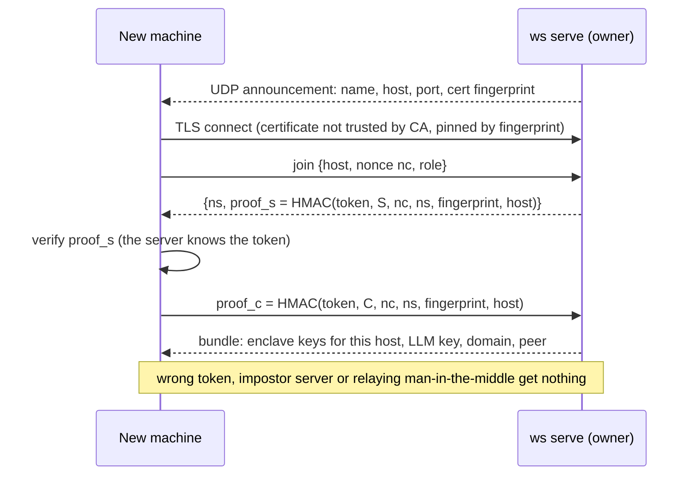

# Workspaces and security (SROS2)

A **workspace** bundles four things so a team of machines can work together and nobody else can listen in:

| Part | What it is |
|---|---|
| SROS2 keystore | authentication + encryption, policy `Enforce`, one enclave per member |
| DDS domain | a number derived for the workspace |
| LLM API key | the bearer token for `llama-server` |
| Join token | a secret that lets a new machine join |

```bash
ros2 run framework_bringup ws create lab             # first machine: prints the invite
source ~/.robocup/workspaces/lab/env.sh              # every terminal that should be inside it
ros2 run framework_bringup ws serve lab              # admits machines, announces itself on the LAN
ros2 run framework_bringup ws discover               # other machine: what is announced here?
ros2 run framework_bringup ws join lab --token ...   # then: source $(ros2 run framework_bringup ws env lab)
ros2 run framework_bringup ws members lab            # who is in, with their roles
ros2 run framework_bringup ws invite lab --role observer    # an invite with its own token and role
ros2 run framework_bringup ws revoke lab HOST        # remove a member and re-key
```

`ws join` also accepts `--invite <string>` (the invite carries host, port, certificate fingerprint, token and role), so no discovery is needed.

## How joining works



Both sides prove they know the token with an HMAC bound to the certificate the client saw, so a wrong token, an impostor server and a relaying man-in-the-middle all get nothing (tested). Outsiders and nodes holding another workspace's keys cannot see or talk to workspace nodes (tested).

## Roles

`ws invite lab --role observer|operator` prints an invite with its own token. The member's SROS2 enclave then only allows that role's topics; DDS Security enforces it.

| Role | Reads | Publishes |
|---|---|---|
| full (owner and default) | everything | everything |
| `operator` | everything | housekeeping plus `bt/task` and `teleop/cmd_vel` |
| `observer` | everything | only ROS housekeeping (a writer on any other topic is refused: `create_publisher` raises) |

Tested: an observer reads what a full member publishes and its writer is refused. Restricted roles still need parameter-service replies or no rclpy node starts.

## Revocation

`ws revoke lab HOST` removes the member, rotates all tokens and the LLM key and re-keys the workspace (new CA), so the old keys stop working; the remaining members re-run `ws join`. Restart `llama-server` with the new key afterwards. The owner cannot be revoked.

## Network

`tools/net/cyclonedds_lan.xml` is a multicast-off peer-list discovery config for networks where multicast is unreliable. `tools/net/timesync.sh` sets up chrony for two machines (the clock matters for DDS security certificates and TF). Cyclone DDS (`rmw_cyclonedds_cpp`) is the RMW used for the secured probes.

## Limits

Tested on one machine only. Roles are fixed in `ws.py` (`ROLES`), not configurable per topic. Join discovery depends on UDP announcements, which a loaded machine can miss: retry, or use `--invite`. Details: `notes/RUNBOOK.md`, `notes/technical_debt.md` T-03.
