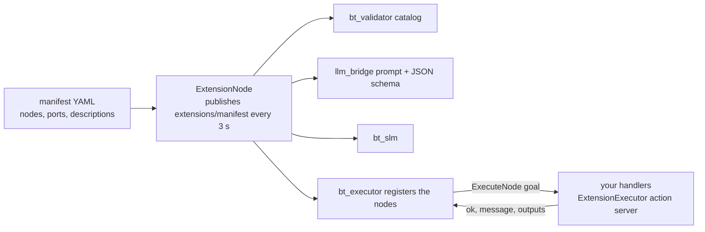

# Writing an extension

An extension gives the robot new behaviour-tree nodes without touching the planner or executor. You write a YAML manifest and a handler function; the framework does discovery, validation, LLM prompting and execution.

## How it fits



Because the manifest feeds the validator, the LLM schema, the SLM and the executor from one file, a new node is usable by the planner as soon as the extension is running. Start extensions **before** sending tasks: if the validator has not yet seen a manifest, the retry path would drop unknown steps (a known hazard; the retry path now refuses instead of dropping, T-22).

## 1. The manifest (`config/<package>.yaml`)

```yaml
extension: social_extension
nodes:
  Speak:
    category: Action            # Action | Condition
    required: [text]
    optional: [person, voice, wait]
    description: "Say text through tts_node; {person} in text is replaced by the person port (unknown -> there); wait=false returns once queued"
```

Rules (checked at load, so a bad manifest fails fast):

* `name` and `ID` are reserved port names; names start with a letter.
* The description is shown to the LLM: say what the node does, when **not** to use it, and what `out_*` ports return. Good descriptions are the cheapest way to improve plan quality (see [Evaluation](evaluation.md): macro and node descriptions fixed most GPSR misses).
* `Action` nodes are exclusive: a second action goal is rejected while one runs. `Condition` nodes are always allowed so they can be polled during an action.
* An optional `out_<name>` port writes the handler's output to the blackboard.

## 2. The handler

```python
from bt_common.executor_node import ExtensionExecutor, port_float, port_str, run_executor


class MyExtension(ExtensionExecutor):
    def __init__(self):
        super().__init__('my_extension')               # reads share/my_extension/config/my_extension.yaml
        self.handlers = {'Wave': self._wave}

    def _wave(self, ports, ctl):
        times = int(port_float(ports, 'times', default=3, lo=1, hi=10))   # raises PortError -> "bad port: ..."
        for i in range(times):
            if ctl.cancelled:                                              # halt arrives as a cancel
                return False, 'cancelled'
            ctl.feedback(f'wave {i + 1}/{times}')
            if not ctl.sleep(0.5):
                return False, 'cancelled'
        return True, 'waved', {'out_count': times}                         # outputs are optional


def main():
    run_executor(MyExtension)
```

Helpers: `port_float(ports, key, default, lo, hi)`, `port_str`, `port_bool` (all raise `PortError` on bad input, reported as `bad port: ...` to the tree); `call_action(client, goal, ctl, timeout)` and `call_service(client, request, ctl, timeout)` wait for another node while honouring cancellation.

Return `(ok, message)` or `(ok, message, {"out_x": value})`. The handler **must** poll `ctl.cancelled` in any loop longer than a moment, because `bt_executor/halt` and every safety stop arrive as action cancels.

## 3. Package wiring

* `setup.py` installs `config/*.yaml` and `launch/*.py`, and defines the console script `my_extension_node`.
* A launch file `launch/my_extension.launch.py` starts the node; add the node to `framework_bringup/launch/extensions.launch.py` and to `param/extensions.yaml` if it has parameters.
* Anything that moves the robot must publish to a `*/cmd_vel` topic that `cmd_vel_mux_node` listens to (add a priority there), never straight to the robot. Use `ScanGuard` (`bt_common`) for lidar clearance as `odom_extension` does.
* Run `ros2 run framework_bringup check_params` so unknown parameter keys are caught.

## 4. Test it without hardware

`tools/integration/fake_recovery_ext.py` is a complete minimal extension (two nodes, no robot) and shows the whole pattern, including cooperative failure injection. For your own tests:

```bash
export ROS_DOMAIN_ID=88 ROS_AUTOMATIC_DISCOVERY_RANGE=LOCALHOST     # own domain, never the robot's
ros2 run my_extension my_extension_node &
ros2 run bt_validator validate_bt --list-nodes | grep Wave           # visible to the validator?
```

Add unit tests next to the package and, if the node is part of a macro, add the macro to `param/macros.yaml` with `example_args` and a name in `whitelist:`: `test_macro_library.py` validates every macro against the real catalog.

## Checklist

- [ ] Manifest descriptions say when **not** to use the node.
- [ ] Every port validated with `port_*` helpers and ranges.
- [ ] Loops poll `ctl.cancelled`; a halt returns promptly.
- [ ] Motion goes through the mux; a guard stops it near obstacles.
- [ ] Works in dry-run (the executor never calls you) and with a fake for tests.
- [ ] A macro and an eval command exist if the LLM should use it.
